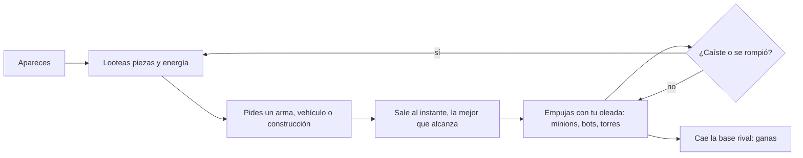

# GDD — GameJamm (título por definir)
<!-- Tope: 400 líneas. Aquí vive QUÉ es el juego y POR QUÉ. Lo que falta, quién lo hace y los commits viven en
docs/DEVLOG.md y en las tareas; los números reales viven en los datos. -->

**Versión 2.0 (14 nov 2026).** Reescrita por decisión de Javier, único integrante activo esa noche, con el equipo
avisado. Conserva la regla de construcción (§3) y el contrato de receta JSON. Es la base del trabajo desde la noche del
14 al 15 nov; cada sección se marca ✅ cuando Javier la revise. La revisión de la v1 contra el código está en el devlog.

## Cómo leer este documento
- **✅** = revisado y aprobado. **❓** = decisión abierta; todas están juntas en §16.
- **Los números son de ejemplo.** Los de verdad viven en `Content/Game/*/Data/*.json` y en `UJamPartCatalog`
  (`Source/GameJamm/Building/JamBuildPart.cpp`). Si el GDD y el dato no coinciden, manda el dato y se corrige el GDD.
- **En el código (fecha):** una línea con lo que ya existe, comprobado leyendo el código.
- **Hecho cuando:** la prueba para dar algo por terminado.
- No se nombra el juego de referencia (ver `docs/mechanics-research/FORMATO.md` §5).

## 1. El juego en una frase
Pides con tus palabras **un arma, un vehículo o una construcción**; una IA elige qué piezas 3D usar y cómo unirlas, y lo
que sale **funciona por física**: las propiedades de sus piezas deciden lo que hace. Con eso derribas la base del equipo
rival.

- **Tipo de juego:** shooter por equipos con construcción física, contra bots, en tercera persona (§12).
- **Gancho:** "lo que pides existe y funciona". Un rifle con boca de hielo congela; un carro con lanzallamas quema lo que
  arrolla. Nadie programó un "rifle de hielo": salió de sus piezas.
- **Lo que nadie más junta:** lenguaje natural + piezas con física real + combate por equipos.
- **Clip mudo de 3 s:** escribes "un rifle que dispare fuego" → aparece en tu mano → disparas y un minion arde.
  Segundo clip: "un carro que queme todo" → se arma frente a ti → lo manejas entre los minions.

## 2. Pilares
Si una idea no sirve a ningún pilar, sobra.
1. **Lo que construyes determina lo que hace.** Nada de objetos cerrados: las mecánicas salen de las piezas (§3).
2. **Se entiende sin leer.** En 10 s sabes qué hacer y antes del minuto 2 ya tienes algo pedido que funciona.
3. **Todo pedido sale y sirve.** Siempre aparece algo que dispara, se mueve o empuja. Si faltan piezas, sale una versión
   reducida y el juego dice qué faltó.
4. **Lo que armas importa en la partida.** Su daño cuenta como tuyo, te da recompensa y el rival lo puede romper.
5. **Cada acción se ve y se oye** (§10).

## 3. Regla de construcción (base del juego, conservada de la v1)
El jugador combina muchas piezas básicas (tablas, llantas, cilindros, bloques, motores, lanzallamas, cañones…) y **las
propiedades de las piezas se traducen en mecánicas**.
1. **Mecánicas por propiedades, no objetos cerrados.** Una rueda con lanzallamas rueda y quema porque combina `Wheel`
   (rotación) con `Flamethrower` (fuego), no porque exista una "Rueda Infernal" programada a mano.
2. **Catálogo por datos:** [`BuildKnowledge.json`](../Content/Game/Building/Data/BuildKnowledge.json) (capacidades, caras,
   masa, energía, sustitutos, sinónimos) más la tabla física de `UJamPartCatalog`. Agregar una pieza = agregar datos.
3. **Capa de decisión:** el modelo **solo elige** (concepto, piezas, extras). **El código decide lo posible:** valida, usa
   el inventario, sustituye, reduce y dice qué falta (§5.3).
4. **Siempre hay respaldo** sin red ni clave (palabras clave y recetas), para que el juego nunca se bloquee.
5. **Prioridad de recorte:** lo que no sirve a esta regla se recorta primero. Cambiar este enfoque se anota en el
   Historial con fecha y motivo, y se avisa al equipo.

| Propiedad de la pieza | Mecánica que produce |
|---|---|
| Rotación (llanta, cilindro) | Rodar, vehículos, rodillos que aplastan |
| Empuje (motor, cohete) | Movimiento propio, lanzamientos, saltos |
| Daño de contacto o fuego (lanzallamas, púas) | Daño en área, quemadura |
| Masa y solidez (tabla, bloque) | Muros, puentes, escudos, contrapesos |
| Anclaje (puntos de unión) | Qué se conecta con qué y en qué orientación |
| Boca de arma (cañón, hielo, rayo, láser) | Qué dispara el arma de mano y qué le hace al blanco (§5.1) |

## Tema: DIRECTOR'S CUT
Texto oficial ([itch.io](https://itch.io/jam/2026-epic-ai-megajam)): *"Your vision, your edits, your final cut. […] Using
AI agents? You're directing those too. Set the vision, delegate tasks, and decide what makes the cut."*

El tema no es de cine: habla de **la función que siempre se recorta** y de **dirigir a tus agentes de IA**.
1. **La función que siempre se recorta:** construir con física, a partir de palabras, dentro de un juego de combate.
2. **Diriges a tu agente:** le das tu visión ("algo que ruede y queme todo") y él decide con qué piezas.
3. **Tu corte final:** la pantalla final muestra tu mejor creación de la partida, con el pedido que la creó (§9).

Dirección de arte, UI y audio: [ART.md](ART.md).

## 4. El loop
- **Segundos:** pides (B o voz) → aparece en tu mano o frente a ti → disparas (clic) o la enciendes (C) y la manejas (E).
- **Minutos:** looteas piezas y energía → pides algo más fuerte → empujas con tu oleada hacia la siguiente torre.
- **Partida (≤ 15 min):** torre 1 → torre 2 → base rival. Si caes, reapareces y vuelves a pedir.



## 5. Lo que pides
### 5.1 Armas de mano (nuevo; obligatorio)
- **Pedido:** "un rifle que dispare hielo", "una escopeta de fuego", "un lanzacohetes", "una pistola de rayos".
- **Se arma de piezas chicas de arma:** empuñadura + cuerpo + **boca** (el efecto) + extras. Cada pieza aporta una propiedad:

| Pieza | Propiedad → mecánica |
|---|---|
| Boca de cañón | Proyectil que explota |
| Boca de lanzallamas | Quema |
| Boca de hielo | Ralentiza; varios impactos congelan |
| Boca de rayo | Aturde |
| Boca de láser | Línea recta sin caída |
| Cañón largo | Más alcance y daño, dispara más lento |
| Varios cañones | Dispara en abanico (escopeta) |
| Mira | Más alcance |
| Cargador o batería | Menos gasto por disparo |
| Culata | Menos dispersión |
| Hoja | Golpe cuerpo a cuerpo |

- **Munición = tu energía** (la misma barra de §7): cada disparo gasta según su boca. Sin energía, no dispara.
- **Convive** con la espada y el arco: Q o la rueda cambian entre espada, arco y tu arma pedida (❓ §16).
- **Sin clave** la decide el respaldo por palabras clave: el vocabulario de armas (pistola, rifle, escopeta, lanzacohetes,
  ballesta, "que dispare…") vive en datos, igual que el de vehículos.
- **En el código (14 nov):** la espada y el arco ya aplican 5 efectos (`Fusion.json`: Fuego, Hielo, Rayo, Roca, Bomba) que
  pegan a personajes y cuentan como daño del jugador; la flecha lleva su efecto (`Arrow->Fused`). El arma pedida reusa
  esa vía: la boca elige el efecto y no gasta material.
- **Assets:** piezas de arma nuevas (empuñadura, gatillo, culata, cañón corto y largo, mira, cargador, tambor, boca) con
  Rodin o Tripo, normalizadas como las de construcción. Mientras llegan, sirven las mallas de dispositivos que ya tienen
  tamaño de mano (cañón 70 cm, lanzallamas 40 cm, láser 50 cm).
- **Hecho cuando:** sin clave, "un rifle que dispare hielo" pone en tu mano un arma visible hecha de piezas, el clic
  dispara, el blanco se ralentiza y el HUD dice nombre, efecto y gasto; otra frase da otra boca y otro efecto.

### 5.2 Vehículos y construcciones
- 49 tipos de pieza y 21 conceptos (carro, tanque, catapulta, dron o helicóptero, barco, torreta, robot…). Sale apagada a
  unos 6 m frente a ti; **C** la enciende, **E** te sube al asiento, **W/S A/D** manejan, clic dispara sus armas.
- **Lo que hoy la limita no son las mallas:** sin clave decide el respaldo por palabras clave, y con pocas piezas el
  solver la reduce a un carro. Mejoras: vocabulario en datos y suficiente loot al empezar.
- **Solo tuya:** X desarma **tu** construcción y te devuelve las piezas que siguen existiendo; E solo sube a la tuya.
- **En el código (14 nov):** X borra todas las construcciones del mapa (también las de los bots); las piezas no tienen
  vida; E sube a la pieza más cercana de cualquiera.
- **Hecho cuando:** las frases de ejemplo del HUD salen como lo que piden con el cofre inicial más el primer loot, y X
  solo toca la tuya.

### 5.3 Cómo decide la IA (capa de decisión)
- **Orden real:** TypeSafe (Jev) → Jev por OpenRouter → planificador por fal; sin ninguna clave, palabras clave. El modelo
  elige; el solver ajusta la receta al inventario (sustituye dentro de la misma capacidad, reduce, dice qué faltó).
- **El respaldo no es un plan B escondido:** es lo que juega un juez si la build no lleva clave. Tiene que entender las
  frases más probables de armas y vehículos.
- **Tiempo:** con clave, un pedido hoy espera hasta 8 s (más 8 del planificador). Objetivo: corte a 3 s al respaldo y
  "Pensando…" en el HUD mientras espera.
- **Clave para la build de los jueces:** ❓ (§16). Nunca va al repo: `Config/DefaultSecrets.ini` o variables de entorno.

### Formato de receta (contrato entre IA y sistema de construcción)
```json
{
  "name": "Rueda Infernal",
  "parts": [
    {"id": "p0", "type": "Wheel"},
    {"id": "p1", "type": "Flamethrower", "attach_to": "p0", "socket": "Right"}
  ],
  "activate": ["p0", "p1"]
}
```
El asistente solo puede usar piezas del inventario; el juego valida la receta antes de construir. Valores válidos de
`socket` y `type`: [CATALOGO-ELEMENTOS §0.1](assets/CATALOGO-ELEMENTOS.md). **Este contrato no cambia sin avisar.** El
arma de mano usa la misma receta (piezas de arma como `type`).

## 6. La partida: Asalto
- **Objetivo, siempre en pantalla:** derriba la torre 1 → la torre 2 → la base rival. La base está protegida hasta que
  caen sus dos torres.
- **Equipos:** tú + 2 bots contra 3 bots. Minions cada 30 s por base. Las torres hacen la mitad de daño si no vas con tus
  minions: hay que empujar con la oleada.
- **Duración:** 15 min, muerte súbita al minuto 12. Si nadie cae, gana quien tenga más vida en torres y base (❓ empate).
- **Sin online (decidido 14 nov):** los jueces juegan solos y replicar construcciones con física es lo más caro. La página
  dice "por equipos contra bots".
- **En el código (14 nov):** oleadas, torres, regla de escolta, base protegida, reloj, muerte súbita, VICTORIA/DERROTA.

| Tiempo | Qué pasa | Qué siente el jugador |
|---|---|---|
| 0:00 | Objetivo en pantalla y cofre inicial a 5 m | "Sé qué hacer" |
| 0:00–2:00 | Pide un arma y la prueba; pide un vehículo | "Lo que pido existe" |
| 0:30 | Primera oleada | "El carril se mueve aunque yo no" |
| 2:00–5:00 | Empuja a la torre 1; islas de loot a los lados | "Mi creación contra la suya" |
| 5:00 | Cofre raro en la pradera central | "Vale la pena arriesgarse" |
| 8:00+ | Minions pesados | "Hay que cerrar" |
| 12:00 | Muerte súbita | "Se acelera" |

## 7. Loot, mochila y energía
- **Loot:** cofre inicial junto al spawn, cofres de piezas comunes y de dispositivos en las islas, chatarra en el campo y
  cofre raro en la pradera. Se abren al pasar encima. Datos: [`Loot.json`](../Content/Game/Core/Data/Loot.json).
- **Mochila:** topes por tipo y total (datos en `Loot.json` → `caps`). Lo que no cabe se queda en el suelo.
- **Energía (tipo maná):** mínimo garantizado que se recarga solo, máximo que solo se alcanza looteando y ganando peleas.
  La gastan los dispositivos encendidos y los disparos del arma pedida.
- **Al morir:** sueltas una bolsa con la mitad de tus piezas y renaces con la otra mitad (❓ §16).
- **En el código (14 nov):** se renace con 0 piezas (el inventario muere con el personaje); los bots construyen sin
  gastar piezas.

## 8. Los primeros 2 minutos (para los jueces)
Una línea de objetivo arriba guía paso a paso; cada paso se cumple y aparece el siguiente.
1. "Pasa por el cofre junto a ti" (trae piezas para un carro con lanzallamas y para un arma).
2. "Pulsa B y pide un arma. Prueba: *un rifle que dispare fuego*" → dispara a los muñecos de práctica junto al spawn.
3. "Pulsa B y pide un vehículo. Prueba: *un carro que queme todo*" → "C lo enciende, E te subes".
4. "Sigue a tus minions hasta la torre 1".
5. "Derriba las dos torres y la base rival".
- **H** muestra los controles; la ayuda no tapa la pantalla por defecto.
- **Hecho cuando:** alguien que nunca lo jugó llega a la torre 1 con un arma y un vehículo pedidos antes del minuto 3, sin
  leer nada fuera del juego.

## 9. HUD y pantallas
| Zona | Qué muestra |
|---|---|
| Arriba al centro | Objetivo actual (§8) y avisos grandes (cofre raro, torre caída, muerte súbita) |
| Arriba a la izquierda | Reloj y vida de torres y base de cada equipo |
| Centro abajo | Línea del asistente: lo que entendió, qué armó y qué faltó ("Pensando…" mientras espera) |
| Abajo | Vida y energía; arma en mano con su nombre, efecto y gasto |
| Sobre tu construcción | Encendida o apagada |

- **Sin paneles de depuración por defecto** (lista de elementos, comandos de consola, "Sentido N/100").
- **Pantallas:** título (nombre + objetivo + "Enter para jugar"), muerte (cuenta atrás), **final "tu corte final"**:
  victoria o derrota, tu mejor creación con el pedido que la creó, y R para la revancha.
- **En el código (14 nov):** los avisos del cofre y del asistente usan el canal de depuración del motor, que la build
  Shipping no muestra; la ayuda sale abierta y tapa media pantalla.

## 10. Sensación por evento
| Evento | Imagen | Sonido | Física |
|---|---|---|---|
| La IA arma | Las piezas aparecen con destello | `SFX_Build_Pop` por pieza | Cae al suelo con peso |
| Disparo del arma pedida | Fogonazo del color de su boca | Según la boca (`SFX_Cannon`, `SFX_Fire_Loop`, `SFX_Ice`, `SFX_Shock`) | Retroceso leve |
| Encender / apagar (C) | Brillo de los dispositivos | `SFX_Power_On` / `SFX_Power_Off` | El vehículo arranca |
| Golpe o impacto | Número de daño del color del efecto | `SFX_Hit` | Empuje al blanco |
| Explosión | Fuego y humo, cámara tiembla | `SFX_Explosion` | Empuja cuerpos cerca |
| Sin energía | La barra parpadea en rojo | `SFX_Energy_Empty` | Todo se apaga |
| Recoger loot / abrir cofre | Contador sube | `SFX_Loot_Pickup` / `SFX_Chest_Open` | — |
| Torre destruida | Aviso grande | `SFX_Tower_Destroyed` + `SFX_Fanfare` | — |
| Morir / reaparecer | Cuenta atrás | `SFX_Death` / `SFX_Respawn` | El cuerpo cae |

- **Música:** `MUS_Match_Loop` en partida, `MUS_Match_Intense_Loop` en muerte súbita, `MUS_Menu_Loop` en título y final.
- **En el código (14 nov):** el juego no suena. El código pide 8 de estos sonidos con el nombre exacto pero busca en
  `/Game/Game/Building/Audio/`, donde no hay nada importado; los WAV están en `SourceArt/Audio/`.

## 11. Controles
| Acción | Teclado y mouse |
|---|---|
| Moverse, mirar, saltar | WASD, mouse, Espacio |
| Atacar o disparar | Clic izquierdo |
| Cambiar arma (espada, arco, arma pedida) | Q o rueda |
| Pedir por texto / por voz | B (o T, Enter) / mantener G (voz solo con clave de fal) |
| Encender o apagar tu construcción | C |
| Subir o bajar del asiento | E |
| Desarmar tu construcción | X |
| Fusionar material a espada o arco | F |
| Cámara / ayuda | V / H |

- **Mando:** hoy no se puede pedir con mando. Fuera de la entrega.

## 12. Cámara (decidido 14 nov)
- **Tercera persona sobre el hombro**, como hoy: el arma pedida se ve en la mano, que es el gancho del video.
- **V** pasa a primera persona. Un FPS completo pide un modelo del arma pegado a la cámara (hoy en V el arma no se ve) y
  queda fuera de la entrega.

## 13. Alcance
**Compuerta de entrega (dom 15 nov, 19:59 CDMX; sin feature freeze desde el 15 nov).** Pregunta: ¿un juez entiende el juego, se divierte 5 min contra bots y ve
que lo que pide existe y funciona? En orden:
1. **Legibilidad:** objetivo y pasos de §8, HUD limpio de §9, avisos en el HUD.
2. **Errores que rompen el ciclo:** X solo la tuya, renacer con piezas, E solo la tuya, reembolso solo de lo que existe.
3. **Arma pedida** (§5.1), mínima pero de punta a punta, con interruptor para apagarla si falla.
4. **Audio** de §10.
5. **Build Development probada** en esta PC; video de 30–60 s; devlog público.

**Núcleo que no se toca:** pedir → sale al instante → funciona; Asalto contra bots; respaldo sin clave.

**Orden de recorte:** (1) cofre raro, (2) topes de mochila, (3) voz, (4) fusión, (5) pistas de "primera vez".

**Fuera:** juego en red; el segundo modo en una isla; construir a mano pieza por pieza; repetir o editar el pedido
("ahora ponle fuego"); lanza, mazo y escudo; mando completo; FPS completo; menú de opciones y volumen.

**Video de 30–60 s:** pedir el rifle → dispararlo; pedir el carro → manejarlo entre minions; torre cayendo; pantalla
"tu corte final".

## 14. Premios y cómo los atacamos
Criterios de los jueces (1–5): ambición e innovación, tema, diversión, jugabilidad, visuales, diseño de niveles y
progresión, **audio**. El uso de IA no puntúa por sí mismo.

| Premio | Qué pide | Cómo lo atacamos |
|---|---|---|
| Best Overall — Unreal Engine ($7,500 / $5,000 / $2,500) | Juego completo | Todo §13 |
| ↳ OpenAI Award ($5,000 en créditos) | Mejor uso de modelos o productos de OpenAI | Conceptos de arte con un modelo de OpenAI; asistente con un modelo de OpenAI si hay clave ❓ |
| Best Student Project ($7,500 / $5,000 / $2,500) | Inscritos en educación superior | Todos somos estudiantes; requisitos por equipo ❓ |
| Best Team ($5,000) | 2 o más integrantes | Automático |
| Glass Box ($2,500 + ROG Ally por integrante) | Devlog público de cómo se hizo | `docs/DEVLOG.md` + versión pública en itch.io |
| Render Royalty ($2,500), con NVIDIA RTX (RTX 5090) y OpenAI ($2,500 en créditos) | Mejores visuales | Solo si sobra tiempo; NVIDIA pide DLSS 4.5, NvRTX o ACE |
| Partners: Hyper3D Rodin (bolsa de $10,000), Tripo, Meshy | Listarlos en "Tools used" | Rodin y Tripo ya se usan en arte y en las piezas de arma |

- **Por confirmar:** si una entrega puede ganar una categoría principal y un Modifier; los requisitos de Student Project
  para un equipo; que la build Development sea la recomendada (la página lo dice; confirmar al empaquetar).
- Checklist de entrega: [SUBMISSION.md](SUBMISSION.md).

## 15. Riesgos y datos de juego
1. **Primer dato (Javier, 14 nov):** "injugable, no se entiende nada": no sabe qué hacer al empezar, construir no sirve, la
   partida es caótica y sin meta, la pantalla está saturada. Causas encontradas en el código: avisos invisibles en
   Shipping, ayuda que tapa la pantalla, pistas que se contradicen, objetivo que nunca se dice, respaldo que casi solo
   entiende carros. Mitigación: §8, §9 y §13.
2. **Sin clave, el lenguaje natural es el respaldo:** vocabulario en datos y clave para la build de los jueces ❓.
3. **Latencia del modelo (8–16 s):** corte a 3 s y "Pensando…".
4. **Rendimiento con física** (GTX 1650; 60 FPS medidos quietos en el spawn, no en combate): tope de piezas por
   construcción y las construcciones de los bots se borran solas.
5. **Alcance para una persona más agentes:** la compuerta y el orden de recorte de §13 mandan.

## 16. Preguntas abiertas
1. **Clave para la build de los jueces:** la de fal (la tiene Jesús); confirmar con él.
2. **Al morir** (§7): renacer con la mitad, con todo, o como hoy.
3. **Empate a los 15 min:** quién gana.
4. **Arco:** se queda junto al arma pedida o lo reemplaza.
5. **Título del juego.**
6. **Student Project:** requisitos para un equipo.

## Historial
- **v1 · 12–14 nov 2026 · equipo:** regla de construcción, Asalto con minions y bots, loot, energía, fusión, segundo modo.
- **v2 · 14 nov 2026 · Javier:** reescritura por decisión de Javier, único integrante activo esa noche, con el equipo
  avisado. Entran las armas de mano pedidas, el objetivo legible, los primeros 2 minutos guiados y los premios; quedan
  fuera el juego en red y el segundo modo. Formato nuevo: ✅/❓, números en datos, "En el código" y "Hecho cuando".
- **v2.1 · 15 nov 2026 · Javier:** se quita el feature freeze de las 12:00 (metía fricción); se trabaja en completar
  este GDD hasta el paquete final y lo único fijo es el deadline (19:59 CDMX). Misión del día: terminar el juego con o
  sin el resto del equipo; si no llegan, Javier lo sube. Entran audio nuevo con Stable Audio 3 (local), UI de loot más
  clara, mejoras del mapa y la capa de decisión con clave (Jev, o un modelo de OpenAI por fal si Jev no está).
