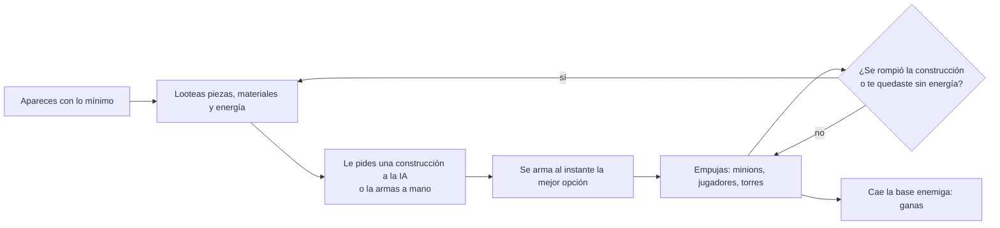

# GDD — GameJamm (título por definir)

## ⚠️ REGLA PRINCIPAL (no negociable): construcción emergente con física (sandbox)
**La idea central del juego es un sistema donde el jugador arma estructuras combinando muchos elementos básicos (tablas/paredes, llantas, cilindros, bloques, rocas, motores, lanzallamas…) y las propiedades de esas piezas se traducen en mecánicas.** Lo que construyes determina lo que hace. Todo lo demás (tower push, loot, fusión, bots, arte) existe para alimentar este sistema.

Reglas derivadas, valen para todos los roles y para cualquier agente de IA:
1. **Las mecánicas salen de las propiedades de las piezas, no de objetos cerrados.** Una "rueda con lanzallamas" rueda y quema porque combina `Llanta` (rotación) con `Lanzallamas` (daño de fuego), no porque exista un objeto "Rueda Infernal" programado a mano.
2. **Catálogo grande de piezas, definido por datos:** [`Content/Game/Building/Data/BuildKnowledge.json`](../Content/Game/Building/Data/BuildKnowledge.json) (capacidades, caras válidas, masa, energía, sustitutos y sinónimos para la IA) más la tabla física de `UJamPartCatalog` en `Source/GameJamm/Building/JamBuildPart.cpp` (tamaño, masa, potencia; pasará a DataAssets). Cada pieza declara forma, masa, puntos de anclaje y *capacidades* (rotar, empujar, dañar, quemar, soportar peso, bloquear…). Diseño completo: [research 13](mechanics-research/13-conocimiento-ia-construccion.md).
3. **Capa de decisión:** un modelo recibe el pedido del jugador y su inventario y *decide* qué piezas usar y cómo ensamblarlas (receta JSON). El juego valida y construye. Ver [Capa de decisión](#capa-de-decisión).
4. **Siempre hay fallback** (recetas fijas) para que el juego nunca se bloquee.
5. **Prioridad de recorte:** cualquier feature que no sirva a esta regla se recorta primero. **Nadie del equipo, ni ningún agente, cambia este enfoque sin acuerdo de todos.**

### De propiedades a mecánicas (ejemplos)
| Propiedad de la pieza | Mecánica que produce |
|---|---|
| Rotación (llanta, cilindro) | Rodar, vehículos, rodillos que aplastan |
| Empuje (motor, cohete) | Movimiento autónomo, lanzamientos, saltos |
| Daño de contacto / fuego (lanzallamas) | Daño en área, quemadura |
| Masa y solidez (tabla, bloque, roca) | Muros, puentes, escudos, contrapesos |
| Anclaje (puntos de unión) | Qué piezas se pueden conectar y con qué orientación (constraints Chaos) |
| Fusión de material (piedra/fuego/hielo) | Modifica la pieza: más dura, incendiaria, ralentizadora |

## Pitch
PvP de dos equipos tipo *tower push*: avanza por el mapa destruyendo torres hasta llegar a la base enemiga y destruirla. Apareces **sin loot**; el mapa tiene **estructuras/campamentos** donde peleas y looteas materiales y piezas. Con ellos:
- **Fusionas armas** (piedra en la espada, fuego en la flecha…).
- **Construyes artefactos** con piezas (llantas, tablas, lanzallamas…) — p. ej. una llanta con lanzallamas que rueda por el mapa quemando todo.
- Un **asistente de IA** te ayuda a diseñar creaciones con las piezas que tienes.

## Tema: DIRECTOR'S CUT

Texto oficial del jam ([itch.io](https://itch.io/jam/2026-epic-ai-megajam)):

> *Your vision, your edits, your final cut. Every developer has that one feature that didn't quite make it: the mechanic you
> scoped out at 2 AM, or the idea you shelved and never found a place for. Now's your chance to finally build it. Using AI
> agents? You're directing those too. Set the vision, delegate tasks, and decide what makes the cut.*

El tema **no** es de cine: habla de **la función que siempre se recorta** y de **dirigir a tus agentes de IA**. El mundo no
lleva ficción de estudio de cine (una versión anterior de este doc la tenía por error y se retiró).

**Cómo lo cumplimos** (en las mecánicas, no en el decorado):
1. **La función que siempre se recorta:** construcción libre con física de artefactos improvisados dentro de un PvP. Es la
   típica mecánica que se saca del alcance a las 2 AM; aquí es el centro del juego. Contarlo así en el devlog y en la página.
2. **Diriges a tu agente:** el **asistente de IA** recibe tu visión en lenguaje natural ("algo que ruede y queme todo") y arma
   la creación con las piezas que tienes. Tú decides qué se queda.
3. **Tus ediciones, tu corte final:** puedes pedirle que edite tu última creación ("más rápida", "ahora con fuego"); la IA
   recibe la receta anterior junto con tu instrucción. *(P1: solo si el MVP del asistente ya funciona.)*
4. **Desarmar y reintentar:** si tu creación se atora o se rompe, la desarmas y **recuperas sus piezas** en el inventario para
   volver a intentarlo. Fomenta experimentar y es barato de implementar (destruir el build + devolver los items).

Título del juego: **por definir** (afecta solo a la UI y a la página de itch).

Dirección de arte, UI y audio: **[ART.md](ART.md)** (islas flotantes + campo abierto).

---

# Jugabilidad

> Estado de cada parte: **Decidido** = lo confirmó el equipo · **Propuesta** = diseño para revisar (los números son valores
> iniciales y se ajustan jugando). Datos de piezas: [BuildKnowledge.json](../Content/Game/Building/Data/BuildKnowledge.json) ·
> reglas de la IA: [research 13](mechanics-research/13-conocimiento-ia-construccion.md) · mapa: `SourceArt/World/map_layout.json`.

## 1. Loop de juego



Cada vuelta del loop, el jugador decide **qué construir con lo que trae**. Lootear mejor da construcciones más fuertes, y ganar
peleas da la energía de otros. Por eso explorar y pelear importan tanto como construir.

## 2. Modos de juego — Decidido: los dos son PvP

| | **Asalto** (modo principal) | **Choque en la isla** (segundo modo) — Propuesta |
|---|---|---|
| Idea | Tower push: destruir 2 torres y la base enemiga | Arena: sacar o destruir a los rivales en una isla flotante |
| Equipos | 3 vs 3 | 2 vs 2 o todos contra todos (4) |
| Mapa | Carril de ~250 m: base → puente → isla de torre 2 → pradera central (torres 1 y río) → torre 2 → base, más 4 islas de loot (blockout de Emilio) | Una isla central del mismo set (pradera o isla de loot) con orillas sin barandal |
| Minions | **Sí** (§3) | No |
| Loot | Campamentos fijos y drops (§4) | Cajas que **caen del cielo** cada 20 s en puntos al azar |
| Cómo se gana | Cae la base enemiga | Primero a 10 eliminaciones, o el último en pie de 5 rondas. Tirar a alguien de la isla cuenta como eliminación |
| Duración | 12–15 min | 5 min |
| Por qué | Aquí brillan los vehículos, las torretas y los arietes contra las torres | Partidas cortas para el video y para jueces con poco tiempo; las construcciones que embisten y empujan se lucen |

**Bots en los lugares vacíos (Decidido por alcance):** cualquier lugar sin humano lo ocupa un bot. Los jueces juegan solos, así
que el caso base es **1 humano + 2 bots aliados contra 3 bots**. Jugar en red humano contra humano es la meta del diseño, pero
el juego tiene que funcionar completo solo con bots.

> [!warning] Riesgo
> La red (replicar construcciones con física) es lo más caro de todo. Prioridad: Asalto contra bots > Choque contra bots >
> PvP en red (LAN o listen server). Si la red no llega, el PvP se muestra con bots y se dice en la página.

## 3. Minions en el PvP — Propuesta

Sí, en Asalto hay minions. Le dan ritmo al carril, son blanco para las construcciones y frenan a quien empuja solo.

| Regla | Valor |
|---|---|
| Oleadas | Cada **30 s** sale de cada base: 3 de cuerpo a cuerpo + 1 a distancia. Desde el minuto 8, +1 "pesado" que aguanta más |
| Ruta | Siguen el carril, pelean con lo primero que encuentran: minions, jugadores, construcciones y luego torres |
| Vida / daño | Cuerpo a cuerpo 60 HP / 8 por golpe · A distancia 40 HP / 6 · Pesado 200 HP / 15 |
| Torres | Disparan primero a los minions enemigos en rango. **Cambian a un jugador** si ese jugador le pega a un jugador aliado cerca de la torre |
| Daño a torres | Un jugador o construcción que golpea una torre **sin minions aliados cerca** hace 50 % de daño. Hay que empujar con la oleada, no meterse solo |
| Recompensa | Cada minion suelta **energía +3**; el pesado suelta además una pieza común al azar |

## 4. Loot — Propuesta

**Apareces casi sin nada (Decidido):** solo el asiento (infinito) y tu barra mínima de energía. Todo lo demás se lootea.

**Dónde sale cada cosa** (usa las 4 islas de loot del blockout):

| Lugar | Qué da | Reaparece |
|---|---|---|
| Isla de loot cercana a tu base (2, una por lado) | Piezas comunes: Plank, Block, Cylinder, Wheel + material de fusión común | Cofre 60 s |
| Isla de loot de media distancia (2, del lado enemigo y propio) | Dispositivos: Fan, Flamethrower, Cannon, Battery, Spring, Wing | Cofre 90 s; la custodian 3 enemigos neutrales |
| Pradera central (evento) | **Cofre raro** al minuto 5 y cada 3 min: Jet, Turbine, Beam, HoverStone, Rocket, BigWheel | Una vez por evento; se anuncia en pantalla |
| Montones de chatarra en el campo | 1–2 piezas comunes al romperlos | 45 s |
| Minions y enemigos de campamento | Energía (+3 / +10) y a veces una pieza | — |
| **Jugador eliminado** | Suelta una **bolsa** con 50 % de sus piezas (redondeado abajo) y 50 % de su energía sobre el mínimo | La bolsa dura 30 s en el suelo |
| Construcción destruida por un enemigo | 50 % de sus piezas quedan tiradas para quien las tome | 30 s |
| Construcción que desarmas tú | Recuperas **el 100 %** de sus piezas | — |

**Mochila (límites) — Propuesta:**

| Límite | Valor | Por qué |
|---|---|---|
| Espacio total | **40 piezas** | Obliga a elegir qué cargar |
| Por tipo común (Plank, Block, Cylinder, Wheel, Panel) | 8 de cada una | Alcanza para un carro de 4 ruedas y piezas de repuesto |
| Por dispositivo (Fan, Flamethrower, Cannon, Frost, Spring, Wing, Battery…) | 4 de cada uno | Evita construcciones con 10 cañones |
| Por pieza rara (Jet, Turbine, Beam, HoverStone, Rocket, BigWheel) | 2 de cada una | La pradera central vale la pena pelearla |
| Materiales de fusión | 10 de cada uno, aparte de las piezas | — |
| Asiento | Infinito, no ocupa espacio | Decidido |
| Construcción | **21 piezas** máximo, **1 construcción activa** por jugador (hacer otra desarma la anterior y devuelve sus piezas) | Rendimiento y claridad en PvP |
| Por construcción | Máximo 4 armas (Flamethrower, Frost, Cannon, Beam, Bomb) y 6 propulsores (Fan, Turbine, Jet, Rocket) | Balance |

Al recoger algo con la mochila llena, el HUD lo marca y no se recoge. Puedes tirar piezas desde la mochila (Tab).

## 5. Energía — Decidido: tipo maná, con mínimo garantizado

| Regla | Valor (Propuesta) |
|---|---|
| **Mínimo garantizado** | **50**. Si tienes menos, se recarga sola (+3/s con tu construcción apagada) hasta 50 |
| Máximo | **150**. Lo que pase de 50 **solo** se consigue looteando o ganando peleas |
| Cómo subir de 50 | Cristales de energía (+15 chico, +40 grande) en cofres · minions (+3) · enemigos de campamento (+10) · **eliminar a un jugador**: su orbe trae el 50 % de lo que tenía sobre el mínimo |
| Baterías (Battery / BigBattery) | Piezas que pegas a tu construcción: reserva de 30 / 80 que se gasta antes que tu barra |
| Al morir | Conservas el mínimo (50). Lo de arriba lo suelta tu orbe |
| Asiento | No gasta (Decidido) |
| Gasto | Ruedas 0.2/s, Fan 1.5, Turbine/Jet 2.5, armas 2.0, Cannon 3.0, HoverStone 0.5, Rocket 0 (es de un uso) |
| Al llegar a 0 | Se apagan los dispositivos; el asiento sigue dirigiendo sin empuje; la barra parpadea |

Así, **quien lootea y gana peleas tiene construcciones más fuertes y que duran más**. Con el mínimo, un carro con ventilador
(2.3/s) dura ~22 s. Con la barra llena (150) dura más de un minuto.

**HUD:** barra de 15 segmentos junto a la vida. Los primeros 5 (el mínimo) van de otro tono. Mientras la construcción está
encendida muestra el gasto actual (−2.3/s), y las baterías pegadas se ven como segmentos extra encima.

## 6. Construir — Decidido: voz, texto y a mano

### 6.1 Por voz o texto: sale directo la mejor — Decidido

Prioridad: **que sea lo más rápido posible**. No hay menú de opciones: Jev elige la mejor y se arma al instante.

1. Mantienes **V** y hablas, o presionas **B** y escribes: *"algo que ruede y queme todo"*.
2. Jev decide en ~0.3 s y **la construcción se arma frente a ti** con la opción que Jev vio mejor para tu pedido
   **y para lo que traes en la mochila**. Queda **apagada**; la enciendes con **C**.
3. Si te faltan piezas, sale **la versión reducida** que sí alcanza (el solver sustituye o recorta) y el Asistente lo dice en una
   línea: *"Armé el carro con 2 ruedas; faltan 2 Wheel, hay en la isla de loot cercana"*. Nunca se queda esperando.
4. Una tarjeta chica muestra **piezas usadas**, **gasto de energía por segundo** y cuánto te dura con tu barra actual.
5. ¿No es lo que querías? **R** vuelve a pedir con otras palabras (desarma la anterior y devuelve sus piezas), **G** la abre en modo
   manual para editarla, o **"ahora ponle fuego"** le pide a la IA que la edite.
6. *(Opcional, P1)* **N**: cambia a la **2.ª opción de Jev** sin volver a llamar. Jev ya devuelve la probabilidad de cada forma,
   así que es instantáneo.

### 6.2 A mano

Con **G**: eliges una pieza de la mochila (rueda del mouse), apuntas a una cara de tu construcción, **clic izquierdo** la pega
y **clic derecho** quita la última. **R** gira la pieza 45° y **Shift+R** gira la construcción completa 45°. Usa el mismo sistema de caras que la IA, así que
**puedes editar lo que armó la IA** y la IA puede editar lo que armaste tú (*"ahora ponle fuego"*).

### 6.3 Encender, manejar y desarmar

- **C** prende o apaga toda la construcción (todos los dispositivos a la vez).
- **E** junto al asiento: te subes o te bajas. Arriba: **W/S** acelera y frena, **A/D** gira, **Espacio/Ctrl** sube y baja si
  vuela; se nivela sola.
- **X** (mantener 1 s): **desarmar**. Recuperas todas las piezas.
- Sin asiento, la construcción funciona sola: va derecho o gira en su lugar (una rueda acostada con lanzallamas es una trampa).

## 7. Controles

| Acción | Teclado y mouse | Control |
|---|---|---|
| Moverse / cámara | WASD / mouse | Stick izq. / der. |
| Atacar / apuntar arco o bloquear | Clic izq. / clic der. | RT / LT |
| Saltar / esquivar | Espacio / Shift | A / B |
| Interactuar, lootear, subirse al asiento | E | X |
| Fusionar material al arma | F | Cruz arriba |
| Cambiar arma (espada, arco) | Rueda del mouse (fuera del modo manual) | Y |
| Asistente: texto / voz | B / mantener V | Cruz izq. / mantener cruz der. |
| Repetir pedido / 2.ª opción de Jev (P1) | R / N | Y / cruz der. |
| Modo manual: elegir pieza / pegar / quitar / girar | G, luego rueda / clic izq. / clic der. / R | Cruz abajo |
| Prender o apagar construcción | C | RB |
| Desarmar | Mantener X | Mantener LB |
| Mochila | Tab | Menú |

## 8. Combate y fusión — Propuesta

### 8.1 Armas

| Arma | Daño base | Velocidad | Alcance | MVP |
|---|---|---|---|---|
| Espada | 20 | 0.6 s por golpe | 2 m | **Sí** |
| Arco | 15 por flecha | 0.8 s al tensar | 40 m | **Sí** |
| Lanza | 16 | 0.7 s | 3.5 m | Stretch |
| Mazo | 32 | 1.1 s | 2 m, empuja | Stretch |
| Escudo | 6 (golpe) | — | Bloquea 70 % de frente | Stretch |

### 8.2 Cómo se fusiona

- **MVP: 5 materiales** (Roca, Fuego, Hielo, Rayo, Bomba; los 5 ya tienen asset en `SourceArt/Fusion/`). Púa queda para Stretch.
- **F** pega **un material** al arma en mano. Un arma lleva **un solo material** a la vez; fusionar otro reemplaza el anterior
  (el anterior se pierde). El material **se gasta con el uso**: dura **20 golpes** (o 1 flecha) y se cae. El arma base no se rompe.
- Las **flechas** se fusionan al tensar: cada flecha gasta 1 material.
- **El material cambia el arma por sus propiedades**, igual que las piezas en la construcción: peso, filo, elemento o dispositivo.

| Material | Qué le hace a la espada | Qué le hace a la flecha |
|---|---|---|
| **Roca** | +12 daño, ×2 empuje, **golpeas 30 % más lento** (pesa) | +8 daño, derriba |
| **Púa / colmillo** *(Stretch: aún sin asset)* | +8 daño, sin penalización | **×2 el bono** (+16): la flecha más fuerte |
| **Fuego** | Quema: +5/s por 3 s; prende pasto y madera | Incendia el punto de impacto |
| **Hielo** | Ralentiza 50 % por 2 s; 3 golpes seguidos congelan 1 s | Congela al blanco; sobre agua hace plataforma |
| **Rayo** | Aturde 0.5 s; se propaga a quien esté mojado | Descarga en área de 2 m |
| **Bomba** | **Al golpear explota** (35 de daño en 2.5 m, también a ti si estás pegado) y se consume en ese golpe | Flecha explosiva |
| **Piezas de construcción** (Stretch) | Fan: empuja al golpear · Spring: te impulsa hacia atrás · Wheel: golpe giratorio | Fan: flecha que empuja · Rocket: flecha de largo alcance |

Fórmula: **daño = base del arma + bono del material** (como en la research de fusión, [02](mechanics-research/02-mecanicas-fusion.md)).
Los efectos (quemar, congelar, aturdir) se acumulan con los de las construcciones: congelar a alguien con flecha y pasarle encima
con un ariete es una combinación válida.

## 9. Balance base — Propuesta

**Alcances y daño de lo que construyes:**

| Pieza | Alcance | Daño / efecto | Gasto |
|---|---|---|---|
| Flamethrower | Cono de **4 m**, 30° | 25/s + quemadura 5/s por 3 s | 2.0/s |
| Frost | Cono de 4 m | Ralentiza 50 % mientras toca; 2 s seguidos congelan 1.5 s | 2.0/s |
| Cannon | Bala hasta ~30 m (con caída) | 40 + explosión de 2 m, cada 1.5 s | 3.0/s |
| Beam | **25 m** en línea recta | 12 cada 0.25 s | 2.0/s |
| Bomb | 3 m de radio | 60, un solo uso | — |
| Choque de la construcción | — | Daño = masa × velocidad (sobre 8 m/s), tope 60 por golpe | — |
| Head (torreta sola) | Detecta a **20 m** | Apunta lo que lleve encima | 0.3/s |

**Vida y defensa:**

| Cosa | Vida | Nota |
|---|---|---|
| Jugador | 150 | Reaparece en 5 s (+1 s por minuto, tope 15 s) |
| Torre | 1500 | Alcance **15 m**, 20 de daño cada 1.5 s (lo que ya hace `ATeamStructure`) |
| Base | 3000 | Solo recibe daño cuando cayeron las 2 torres de ese equipo |
| Piezas de construcción | Plank 60 · Block 150 · Wall 300 · Wheel 80 · dispositivos 80 | Las armas de los jugadores y los minions las rompen; si se rompe una pieza, lo pegado a ella se suelta |
| Contra torres | Las construcciones hacen **50 % de daño a torres y bases** | Ayudan a empujar, pero no derriban una torre solas |

## 10. Una partida de Asalto, minuto a minuto — Propuesta

| Tiempo | Qué pasa | Qué debería sentir el jugador |
|---|---|---|
| 0:00 | Aparecen los 3 de cada equipo en su base. Mensaje: *"Lootea la isla cercana y pídele algo al Asistente (B)"* | Sé qué hacer |
| 0:00–1:30 | Todos lootean su isla cercana (piezas comunes) | Primera construcción en menos de un minuto |
| 0:30 | Primera oleada de minions | El carril se mueve aunque yo no |
| ~2:00 | Primeras peleas en la pradera central, junto a las torres 1 | Mi construcción contra la suya |
| 3:00–5:00 | Se pelean las islas de media distancia (dispositivos) | Arriesgarse da mejores piezas |
| 5:00 | **Cofre raro** en la pradera central (se anuncia 30 s antes); reaparece cada 3 min | Momento de pelea grande |
| 8:00 | Salen minions pesados | Hay que cerrar la partida |
| 12:00 | **Muerte súbita**: las torres hacen la mitad de daño y los jugadores reaparecen en 15 s | Se acelera el final |
| 15:00 | Si nadie destruyó la base: gana el equipo con más vida total en torres y base | Siempre hay ganador |

## 11. Bots y enemigos — Propuesta

**Bots héroe** (llenan los lugares sin humano). Usan **el mismo Asistente** que el jugador, con pedidos fijos según su rol, así
que el sistema de construcción también se luce cuando juegas solo.

| Rol | Qué hace | Pedidos al Asistente (rotan) |
|---|---|---|
| **Constructor** | Lootea la isla cercana y empuja con un vehículo junto a la oleada | "un carro con lanzallamas", "un ariete", "un tanque" |
| **Peleador** | Va a pie con espada fusionada, pelea en la pradera y defiende torres | "una torreta que dispare sola" junto a su torre |
| **Tirador** | Arco con fusión desde atrás, va por los cofres de media distancia | "algo que vuele con cañón" |

Estados (StateTree): **Lootear** → **Construir** → **Empujar con la oleada** → **Retirarse** (vida < 30 %) → **Defender** (si atacan su
torre). Dificultad Fácil, Normal o Difícil: cambia la puntería, cada cuánto construyen y si pelean el cofre raro.

**Enemigos de campamento (neutrales):**

| Enemigo | Vida | Qué hace | Suelta |
|---|---|---|---|
| Guardia | 80 | Cuerpo a cuerpo; persigue hasta 20 m y vuelve | Energía +10 |
| Lanzador | 50 | Lanza piedras desde 15 m | Energía +10 y un material de fusión |
| Jefe de isla (solo en media distancia) | 300 | Golpe en área que empuja | El cofre de la isla se abre al matarlo |

Atacan a cualquier equipo que entre a su isla, así que llegar al mismo tiempo que el rival se vuelve una pelea de tres bandos.

## 12. Los primeros 2 minutos (para los jueces) — Propuesta

Los jueces juegan solos y poco tiempo. Antes del minuto 2 tienen que haber **construido algo que funcione**:
1. **Cofre garantizado** junto al spawn: 1 Plank, 4 Wheel, 1 Flamethrower, 1 Fan y 1 material Fuego.
2. Al abrirlo: *"Presiona B y escribe lo que quieras construir. Prueba: un carro que queme todo"*.
3. La primera construcción **siempre sale completa** (el cofre trae justo lo necesario) y el mensaje explica: *"C para encender,
   E para subirte"*.
4. Pistas de una sola línea la primera vez que pasa algo: primera fusión (F), primera vez sin energía, primera torre a la vista.
5. Menú **Cómo jugar** de una pantalla con los controles de §7 y 3 ejemplos de pedidos.

## 13. HUD y pantallas — Propuesta

**HUD en partida:**

| Zona | Qué muestra |
|---|---|
| Abajo a la izquierda | Vida (150) y **barra de energía** (§5); al encender, el gasto por segundo |
| Abajo al centro | Arma en mano, material fusionado y golpes restantes (20) |
| Abajo a la derecha | Mochila resumida: piezas (x/40) y materiales |
| Arriba al centro | Torres y base de cada equipo (iconos que se apagan), timer y avisos (cofre raro, muerte súbita) |
| Centro, al pedir | Panel del Asistente: lo que dijiste o escribiste, una línea de respuesta y la tarjeta de piezas, energía y lo que falta (§6.1) |
| Sobre la construcción | Vida de cada pieza al dañarse y un icono de encendida o apagada |

**Pantallas:**
- **Inicio:** Jugar Asalto, Jugar Choque en la isla, Cómo jugar, Opciones (volumen, sensibilidad, dificultad de bots), Salir.
- **Muerte:** cuenta atrás para reaparecer y quién te eliminó y con qué construcción.
- **Final — tu corte final** (guiño al tema): Victoria o Derrota, stats (eliminaciones, daño a torres, energía juntada) y la
  **construcción de la partida**: la que más daño hizo, con su nombre, sus piezas y el pedido que la creó. Botones: Revancha y Menú.

## 14. Choque en la isla, en detalle — Propuesta (Stretch)

| Regla | Valor |
|---|---|
| Jugadores | 4 (2 vs 2 o todos contra todos), con bots en los lugares vacíos |
| Mapa | Una isla del blockout, sin barandal; afuera está el mar de nubes |
| Arranque | Mochila vacía, energía mínima (50) y espada |
| Loot | Una caja cae del cielo cada **20 s** en un punto marcado 5 s antes (2–4 piezas al azar, a veces energía o un material) |
| Eliminación | Bajarle la vida a 0 o **tirarlo de la isla** (cuenta para quien lo empujó en los últimos 5 s) |
| Reaparecer | 3 s, en el punto más lejos de los rivales; pierdes la mochila (cae como bolsa) |
| Ganar | Primero a 10 eliminaciones, o el que más tenga a los 5 min |
| Lo que más sirve | Arietes, resortes, ventiladores que empujan y bombas: **sacar del mapa** vale más que hacer daño |

---

## Decisiones clave de alcance
1. **Los dos modos son PvP**, y **cualquier lugar sin humano lo ocupa un bot**. Los jueces juegan solos (1 humano + bots), así que el juego tiene que estar completo contra bots. El PvP en red es la meta, pero va después de que todo funcione contra bots (§2).
2. **El asistente de IA nunca bloquea el juego**: si no hay red/API, usa recetas predefinidas.
3. Contenido mínimo y pulido > mucho contenido roto.

## MVP (tiene que existir el 15 nov a mediodía, antes del freeze)
- [ ] 1 mapa de **1 carril** (o 3 cortos): por equipo **2 torres + 1 base**.
- [ ] Personaje 3ra persona: moverse, atacar cuerpo a cuerpo, arco.
- [ ] Torres/base con vida, disparan a enemigos cercanos; victoria/derrota.
- [ ] Bots: minions que avanzan por el carril + 2–4 bots "héroe" por equipo (StateTree/Behavior Tree).
- [ ] **3–4 campamentos de loot** con enemigos y cofre.
- [ ] **Fusión**: 3 materiales × 2 armas. Ej.: Piedra (+daño/knockback), Fuego (DoT), Hielo (slow). Espada y flecha.
- [ ] **Construcción**: las piezas de `UJamPartCatalog` con física (Chaos constraints), consumo de la mochila, desarmar y recuperar, prender y apagar con una tecla, asiento para manejar (Jugabilidad §6).
- [ ] **Asistente IA**: pedido por texto (voz = P1) → Jev → **se arma al instante la mejor opción** (o su versión reducida) con mensaje de lo que falta (§6.1). Fallback por palabras clave.
- [ ] **Energía**: barra tipo maná con mínimo 50, sube con loot y eliminaciones (§5).
- [ ] **Minions** en Asalto (§3) y **loot** por islas (§4).
- [ ] HUD: vida, inventario de materiales/piezas, estado de torres. Menú inicio + pantalla final.
- [ ] Audio: música + SFX básicos (golpes, fuego, destrucción de torre).

## Stretch (solo si el MVP está listo)
- Segundo modo **Choque en la isla** (§2) contra bots.
- PvP en red (LAN/listen server) para los dos modos.
- Construcción a mano (§6.2), voz, editar la última construcción, fusión con piezas de construcción.
- Más piezas/materiales, vehículos manejables.
- Pantalla de repetición de la mejor jugada.

## Arquitectura técnica (C++ base + BP/DataAssets)
| Sistema | Clases C++ (base) | Contenido BP/Data |
|---|---|---|
| Partida | `AJamGameMode`, `AJamGameState`, `ATeamStructure` (torre/base) | BP de torres, reglas en DataAsset |
| Combate | `UHealthComponent`, `AJamWeapon`, `UFusionComponent` | `UFusionMaterialData` (DataAsset por material) |
| Construcción | `AJamBuildPart`, `UJamPartCatalog`, `UJamAssembler` (receta → piezas + constraints), `AJamBuildSpawner` | `BuildKnowledge.json`; tabla de piezas en C++ (pasará a DataAssets) |
| IA bots | `AJamAIController`, StateTree tasks | StateTrees, carriles (spline) |
| Asistente / decisión | `FJamDecisionClient` (Jev → OpenRouter → fal), `UJamBuildGenerator` (decisiones → receta); interfaz `IBuildDecisionProvider` por hacer | Arquetipos y extras en `JamAssembler.cpp`; `BuildKnowledge.json` |
| Loot | `ALootCamp`, `ALootChest` | Tablas de loot |

### Capa de decisión
La decisión de *qué construir y con qué piezas* va detrás de una interfaz única (`IBuildDecisionProvider`, **por hacer**, junto al cliente actual en `Source/GameJamm/Building/`): entra `{pedido, inventario, contexto}` y sale una receta JSON (formato de abajo, sin cambios). Así el modelo se puede cambiar sin tocar construcción ni combate.

| Proveedor | Estado | Notas |
|---|---|---|
| **Jev** (modelo de decisión de TypeSafe; respaldo vía OpenRouter y fal) | **MVP, ya en código** (`FJamDecisionClient`) | Elige forma, piezas y orientación entre opciones generadas **desde el inventario**; el código arma la receta (solver: sustituye, reduce y pide materiales). Ver [research 13](mechanics-research/13-conocimiento-ia-construccion.md) §3 |
| LLM que escribe el JSON (p. ej. Claude `claude-haiku-5-5`) | Alternativa | Más libre y más lento; el parser ya repara JSON mal escrito (rama `build/recipe-hardening-v2`). Entra por la misma interfaz si Jev se queda corto |
| Palabras clave + recetas fijas | **Fallback obligatorio, ya en código** (`UJamBuildGenerator::ChoiceFromKeywords`) | Se usa sin red, si tarda más de 3 s o si la receta no valida |
| Modelo predictivo tipo JEPA | **Por definir** | Idea del equipo: predecir/evaluar el resultado de varias estructuras candidatas y elegir la mejor. Falta definir qué modelo concreto y cómo se integra (pendiente del material que compartió el equipo) |

El proveedor **solo puede usar piezas del inventario**, y el juego valida la receta antes de construir.

### Formato de receta (contrato entre IA y sistema de construcción)
```json
{
  "name": "Rueda Infernal",
  "parts": [
    {"id": "p0", "type": "Wheel"},
    {"id": "p1", "type": "Flamethrower", "attach_to": "p0", "socket": "Right"}
  ],
  "activate": ["p0", "p1"]
}
```
El asistente solo puede usar piezas que el jugador tiene en el inventario; el juego valida la receta antes de construir. Valores válidos de `socket` y de `type`: [CATALOGO-ELEMENTOS §0.1](assets/CATALOGO-ELEMENTOS.md).

### API key del LLM
No va en el repo. Para la build de los jueces: key con límite de gasto bajo en config del build **o** solo fallback. Decidir el 14 nov.

---

## Pendientes para otras áreas (lo que el GDD pide y falta en su parte)

> Para personas y agentes: si eres dueño del área, toma tu fila, hazlo y márcala `[x]` (o di aquí por qué no). Los cambios al
> diseño se piden en este mismo GDD.

| ✓ | Área (dueño) | Qué falta | Sección del GDD |
|---|---|---|---|
| [ ] | Construcción (Jesús Daniel) | **La energía es del jugador, no de la construcción.** Hoy el código (`c246f4d`) le da a cada construcción su propia energía (`UJamAssembler::BaseEnergy = 100`): eso deja construir una nueva para tener energía llena gratis. Debe gastar de la barra del jugador (mínimo 50, máximo 150, recarga +3/s solo hasta 50 con la construcción apagada, orbe al morir con 50 % de lo que pasa del mínimo); las Battery pegadas siguen como reserva que se gasta primero. Actualizar también `BuildKnowledge.json → energy` | Jugabilidad §5 |
| [ ] | Construcción (Jesús Daniel) | Asistente: armar **al instante la mejor opción de Jev** (o su versión reducida) con una línea de lo que falta; R = volver a pedir; N = 2.ª opción (P1) | Jugabilidad §6.1 |
| [ ] | Construcción (Jesús Daniel) | Mochila: tope por tipo (8 común, 4 dispositivo, 2 rara; campo nuevo tipo `stack_max` en `BuildKnowledge.json`), 40 en total, 1 construcción activa, máximo 4 armas y 6 propulsores por construcción; que el solver lo respete | Jugabilidad §4 |
| [ ] | Combate (Jesús Daniel, por confirmar) | Items de inventario `Mat.Shock` y `Mat.Bomb` para el MVP (hoy solo existen `Mat.Fire`, `Mat.Rock`, `Mat.Ice`); `Mat.Spike` es Stretch | Jugabilidad §8 |
| [ ] | Arte (Emilio) | Material de fusión **Púa/colmillo** (`SM_FUSE_SPIKE`), solo si da tiempo: los otros 5 ya están | Jugabilidad §8 |
