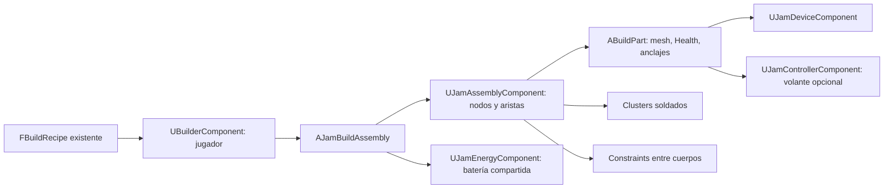

# 12 — Programación de piezas y dispositivos físicos en UE5

> [!info]
> Guía de **cómo programar** el sistema de construcción en UE 5.8 (C++ + Chaos): arquitectura,
> autoría de piezas como assets, snap, weld vs constraint, masa/COM, fuerzas, ruedas, energía,
> separación, estabilidad y plan por roles. Construye encima de [01](01-mecanicas-construccion.md),
> [03](03-mecanicas-vehiculos-dispositivos.md), [08](08-mapeo-ue5-impl.md) y
> [11](11-diseno-ensamblado-open-source.md) sin repetirlos. Generado con un agente (Codex) contra la
> documentación pública de Epic; **los ejemplos de código son propuestas sin compilar**.
> Fuentes en §10 (todas neutras: docs de Epic, foros de UE, repos GitHub).

> [!tip] Decisión central
> **Decisión para estos dos días:** un grafo propio controla las conexiones; las piezas
> rígidas se sueldan en cuerpos compuestos de Chaos; las llantas conservan cuerpos
> separados con bisagras motorizadas. Un único tick del ensamble reparte energía y
> ejecuta los dispositivos. El builder manual y las recetas llaman al mismo servicio.
> Primero debe funcionar una partida contra bots, como exige el GDD; LAN queda detrás
> de ese hito.

> [!warning] Escrito antes del POC `c75b9c9`
> Este doc se redactó cuando `Source/GameJamm/Building/` solo tenía `BuildRecipe`. Después llegó el
> POC de prompt→estructura (`AJamBuildPart`, `UJamPartCatalog`, `UJamAssembler`, `UJamBuildGenerator`,
> `AJamBuildSpawner`). Donde §1–§2 dicen "no hay piezas ni ensamble", ya no es cierto: **no crear las
> clases propuestas en paralelo**; usar la tabla de abajo y aplicar las ideas sobre las clases
> existentes. Decisiones de código → dueño de Building (rol 3, ver [TEAM.md](../TEAM.md)).

| Propuesta de este doc | Ya existe en el POC | Diferencia / qué revisar |
|---|---|---|
| `UBuildPartData` (DataAsset) | `FJamPartDef` + `UJamPartCatalog` (tabla en C++) | El POC ya anota "después DataAsset". Migrar cuando arte entregue meshes (§2.2, §3). |
| `ABuildPart` + `UAttachPointComponent` | `AJamBuildPart` (sin sockets; coloca por `OutwardDir` desde el padre) | Sockets solo hacen falta para el builder manual (§4). Para recetas del LLM el POC basta. |
| `UJamAssemblyComponent` (grafo + un tick) | `UJamAssembler::Assemble` (función estática, sin grafo vivo) | Sin grafo no hay separación por daño ni energía compartida (§6.4, §7). |
| Piezas rígidas con **weld** (`WeldTo`) → un cuerpo compuesto | Cada pieza es un actor con física, unido con constraint **fixed** (`LockAll`) | Es el *fallback* que este mismo doc acepta (§9.1). Riesgo: cadenas de constraints vibran/se estiran con muchas piezas o masas muy distintas (§5.1, §8.1). Probar el caso de 21 piezas antes del freeze. |
| Rueda: twist libre en X del joint, swings bloqueados, drive de velocidad | Igual (`ACM_Free` twist, swings `Locked`, `SetAngularVelocityTarget`) | Coincide. Revisar signo/unidades (el POC divide rad/s entre 2π → RPS, correcto según la API) y dirección (§6.2). |
| Fuerzas en un tick del ensamble con energía compartida | Cada `AJamBuildPart::Tick` hace `AddForce` propio; sin batería | Funciona para el POC; la batería/consumo de [03](03-mecanicas-vehiculos-dispositivos.md) no está implementada (§6.4). |
| Límite de piezas | `UJamAssembler::MaxParts = 21` | Coincide con [01](01-mecanicas-construccion.md). |

Lectura rápida: [integración con el repo](#1-punto-de-partida-y-decisiones-que-faltaban),
[headers](#2-arquitectura-mínima-y-headers-propuestos),
[autoría de piezas](#3-crear-una-pieza-como-asset-paso-a-paso),
[snap](#4-agarrar-detectar-anclajes-y-confirmar),
[física y fuerzas](#5-construir-la-representación-física-y-ejecutar-dispositivos),
[ruedas y energía](#6-llantas-dirección-y-energía-compartida),
[separación](#7-separar-piezas-daño-y-ruptura-del-grafo),
[problemas y red](#8-estabilidad-rendimiento-y-replicación-mínima),
[plan por roles](#9-plan-de-implementación-hasta-el-freeze).

Este documento propone código, no lo incorpora al proyecto. Se revisaron
[CLAUDE.md](../../CLAUDE.md), [README](../../README.md), [GDD](../GDD.md),
[TEAM](../TEAM.md), **todos** los documentos de
[mechanics-research](00-INDEX.md) y todo
[Source/GameJamm](../../Source/GameJamm/). Los ejemplos son esqueletos y rutinas
para implementar, **no una biblioteca compilada ni una prueba ejecutada en UE 5.8**.
La asociación del proyecto es `5.8`; las firmas se contrastaron con documentación
pública de Epic. Cuando una página solo entregó contenido indexado, o corresponde a
otra versión, se indica en las fuentes. Confirmar contra los headers del hotfix del
equipo antes de integrar.

## 1. Punto de partida y decisiones que faltaban

### 1.1 Lo existente y sus límites reales

| Archivo existente | Integración propuesta, sin cambiar el contrato |
|---|---|
| [Building/BuildRecipe.h](../../Source/GameJamm/Building/BuildRecipe.h) y [.cpp](../../Source/GameJamm/Building/BuildRecipe.cpp) | Reutilizar `FBuildRecipe`, `FBuildRecipePart`, `ParseRecipeJson`, `ValidateRecipe` y `GetRequiredItems`. Actualmente **no hay** piezas, builder, catálogo ni ensamble implementados. |
| [Core/InventoryComponent.h](../../Source/GameJamm/Core/InventoryComponent.h) y [.cpp](../../Source/GameJamm/Core/InventoryComponent.cpp) | `Part.<Type>` consume una unidad por pieza. Usar `HasItems` y `ConsumeItems` al confirmar; nunca al mover el fantasma. No replica ni exige autoridad actualmente. |
| [Core/HealthComponent.h](../../Source/GameJamm/Core/HealthComponent.h) y [.cpp](../../Source/GameJamm/Core/HealthComponent.cpp) | Toda pieza dañable lleva `UHealthComponent`. Enlazar `OnDied(UHealthComponent*, AActor*)`; retirar conexiones **antes** de destruirla. `Health` y `bDead` replican, pero `Team` no y los métodos de daño no comprueban autoridad. El llamador debe hacerlo. |
| [Core/JamTypes.h](../../Source/GameJamm/Core/JamTypes.h) y [JamStatics.cpp](../../Source/GameJamm/Core/JamStatics.cpp) | Mantener `EJamTeam::{Neutral,Red,Blue}`. Asignar `Health->Team` explícitamente: el helper encuentra primero el Health de la propia pieza, incluso si sigue en Neutral. `SetOwner` por sí solo no corrige eso. |
| [Core/TeamStructure.cpp](../../Source/GameJamm/Core/TeamStructure.cpp) | Torres reciben daño estándar y respetan prerrequisitos. `FindTarget` solo consulta `ECC_Pawn`: hoy una pieza `PhysicsBody` **no es objetivo** de las torres. Su dueño Core decidirá si amplía ese comportamiento más adelante. |
| [GameJamm.Build.cs](../../Source/GameJamm/GameJamm.Build.cs) | Ya incluye `Engine`, `EnhancedInput`, `Json` y `JsonUtilities`, y permite includes `Building/...`. Para usar tipos/enums físicos explícitos, proponer al Lead añadir `PhysicsCore`. No hacen falta APIs internas de `Chaos`/`ChaosSolverEngine` para este MVP. |
| [GameJamm.uproject](../../GameJamm.uproject) | No habilita Chaos Vehicles ni Modular Vehicles. No asumir que hay vehículo, Pawn o input de construcción listos. |

`ValidateRecipe` ya comprueba ids únicos, una raíz, padres existentes, ausencia de
ciclos, ids de activación e inventario. **No comprueba** allowlist de tipos, sockets,
ocupación, masa, distancia, poses ni colisiones. Esa segunda validación pertenece al
builder, sin alterar el parser compartido. Tampoco asumir orden padre-antes-que-hijo
en `Parts`: recorrerlo topológicamente.

### 1.2 Construir encima de la investigación, no duplicarla

| Lectura previa | Qué se añade aquí |
|---|---|
| [01: interacción de construcción](01-mecanicas-construccion.md) | Resolución de transforms, histéresis, colisión y confirmación transaccional. |
| [03: dispositivos](03-mecanicas-vehiculos-dispositivos.md) | Contrato de ejecución, unidades, cuerpo receptor, ruedas y presupuesto energético propios. No se reutilizan sus tablas de balance. |
| [08: mapeo a UE](08-mapeo-ue5-impl.md) | Distinción entre attach visual, weld físico y constraint. Headers y orden concreto de las operaciones. |
| [10: auditoría de la implementación pública](10-repo-open-source-fusion.md) y [11: grafo y ensamblado](11-diseno-ensamblado-open-source.md) | Grafo mínimo que encaja en la receta **actual**, partición física y desconexión con conservación de velocidades. No crear el DSL nuevo propuesto allí durante el jam. |

El juego de referencia justifica brevemente que dispositivos sencillos puedan
combinarse; su diseño ya está investigado en esos enlaces. Los algoritmos, límites y
valores siguientes son decisiones nuestras.

**Cuatro precisiones sobre las propuestas previas:**

1. `SetSimulatePhysics(false)` + attach sin welding no garantiza que las colisiones,
   masa e inercia del hijo entren al cuerpo del padre. Un cuerpo compuesto requiere
   weld físico o geometría compuesta creada expresamente. Epic describe `WeldTo`
   justamente como unión física con distribución de masa. [API de WeldTo](https://dev.epicgames.com/documentation/unreal-engine/API/Runtime/Engine/Components/UPrimitiveComponent/WeldTo?application_version=5.5)
2. No ignorar toda la pieza destino en el check de colocación: permitiría meter una
   tabla dentro de otra. Usar puntos fuera del collider y una pequeña separación,
   o una prueba de penetración con tolerancia; el MVP usa separación y rechazo.
3. Una bisagra motorizada debe liberar **twist sobre X del frame del joint** y bloquear
   swings. Su orientación no tiene por qué ser la del actor ni la del mesh.
4. Replicar aristas y corregir solo el root no sincroniza cuerpos articulados.
   El grafo describe conectividad, no velocidades ni poses de ruedas. Véase §8.

## 2. Arquitectura mínima y headers propuestos

### 2.1 Tres conceptos distintos

**Pieza:** identidad de gameplay, mesh, vida, datos y comportamiento. **Ensamble:**
componente conexo del grafo lógico; comparte control y energía aunque tenga ruedas.
**Cluster rígido:** componente conexo usando solo aristas `Weld`; corresponde a un
cuerpo físico compuesto. Una tabla y dos cohetes soldados forman un cluster; al
añadir dos ruedas, el ensamble tiene tres cuerpos y dos constraints.



`AJamBuildAssembly` es un coordinador con `USceneComponent` raíz sin colisión.
**No se sueldan piezas a ese SceneComponent.** Cada cluster elige una pieza como
root físico, preferiblemente una tabla/chasis estable; las demás se sueldan
directamente a su `Mesh`, en jerarquía plana. Los cuerpos de ruedas no se parentan
al chasis con un attach que les imponga transform: los relaciona el constraint.
El actor coordinador conserva referencias y mueve su marcador al chasis si hace falta
para relevancia/debug; no gobierna su física.

| Responsabilidad | C++ | Blueprint/DataAsset |
|---|---|---|
| Vida/equipo/inventario | Contratos Core existentes, checks de autoridad en sus llamadores | Vida inicial por pieza; equipo asignado al crear |
| Agarrar y colocar | Estado, traces, snap, validación, commit/cancel | Input Actions, HUD, colores, sonidos |
| Ensamble | Grafo, clusters, constraints, altas/bajas, reparto de energía | Límites y perfiles ajustables |
| Dispositivo | Fuerza, motor, cooldown, consumo y daño | Ejes, magnitudes, duración, VFX/SFX |
| Contenido | Inicialización desde `UBuildPartData` | Static Mesh, colisión, sockets y variantes |

Todas las clases nuevas van bajo `Source/GameJamm/Building/`, rol 3. Se conservan los
nombres `ABuildPart`, `UAttachPointComponent`, `UBuilderComponent`, `UBuildPartData`
del GDD; los tipos genéricos adicionales llevan `Jam`. Cada bloque de header va en
su archivo, con el `*.generated.h` como **último include**. Se omiten implementaciones
rutinarias, no los contratos que consumirá el resto del equipo.

### 2.2 Datos: `Building/BuildPartData.h`

```cpp
#pragma once
#include "CoreMinimal.h"
#include "Engine/DataAsset.h"
#include "BuildPartData.generated.h"

class UStaticMesh;
class UPhysicalMaterial;
class ABuildPart;

UENUM(BlueprintType)
enum class EJamJoinKind : uint8
{
    Weld, FixedConstraint, MotorHinge, SpringSlider
};

UENUM(BlueprintType)
enum class EJamDeviceKind : uint8
{
    None, Thrust, Wheel, Flamethrower, Balloon, Spring
};

USTRUCT(BlueprintType)
struct GAMEJAMM_API FJamAttachDef
{
    GENERATED_BODY()
    UPROPERTY(EditDefaultsOnly, BlueprintReadOnly, Category="Jam|Building")
    FName Id; // Nombre público (cara): Top, Bottom, Front, Back, Left, Right — ver CATALOGO-ELEMENTOS §0.1
    UPROPERTY(EditDefaultsOnly, BlueprintReadOnly, Category="Jam|Building")
    FName MeshSocket; // Si no es None, la pose viene SOLO de este socket
    UPROPERTY(EditDefaultsOnly, BlueprintReadOnly, Category="Jam|Building")
    FTransform LocalPose = FTransform::Identity; // Alternativa sin socket
    UPROPERTY(EditDefaultsOnly, BlueprintReadOnly, Category="Jam|Building")
    FName ConnectorTag = TEXT("Bolt"); // Igualdad en ambos extremos para MVP
    UPROPERTY(EditDefaultsOnly, BlueprintReadOnly, Category="Jam|Building")
    EJamJoinKind JoinKind = EJamJoinKind::Weld;
};

USTRUCT(BlueprintType)
struct GAMEJAMM_API FJamDeviceSpec
{
    GENERATED_BODY()
    UPROPERTY(EditDefaultsOnly, BlueprintReadOnly, Category="Jam|Device")
    EJamDeviceKind Kind = EJamDeviceKind::None;
    UPROPERTY(EditDefaultsOnly, BlueprintReadOnly, Category="Jam|Device")
    FVector LocalAxis = FVector::ForwardVector; // Eje de FUERZA sobre el cuerpo
    UPROPERTY(EditDefaultsOnly, BlueprintReadOnly, Category="Jam|Device")
    FVector LocalApplicationPoint = FVector::ZeroVector; // cm, espacio Mesh
    UPROPERTY(EditDefaultsOnly, BlueprintReadOnly, Category="Jam|Device", meta=(ClampMin="0"))
    float ForceN = 500.f;
    UPROPERTY(EditDefaultsOnly, BlueprintReadOnly, Category="Jam|Device", meta=(ClampMin="0"))
    float PowerW = 10.f; // Unidades de energía por segundo; balance de gameplay
    UPROPERTY(EditDefaultsOnly, BlueprintReadOnly, Category="Jam|Device", meta=(ClampMin="0"))
    float DurationSeconds = 0.f; // 0 = continuo; cohete > 0, no se reinicia al apagar
    UPROPERTY(EditDefaultsOnly, BlueprintReadOnly, Category="Jam|Device", meta=(ClampMin="0"))
    float WheelRPM = 120.f;
    UPROPERTY(EditDefaultsOnly, BlueprintReadOnly, Category="Jam|Device", meta=(ClampMin="0"))
    float MaxTorqueNm = 80.f;
    UPROPERTY(EditDefaultsOnly, BlueprintReadOnly, Category="Jam|Device", meta=(ClampMin="0"))
    float VelocityDriveStrength = 1000.f; // Coeficiente UE, ajustar en editor
    UPROPERTY(EditDefaultsOnly, BlueprintReadOnly, Category="Jam|Device", meta=(ClampMin="-1", ClampMax="1"))
    float MotorSign = 1.f; // +/-1; probar lado izquierdo/derecho
    UPROPERTY(EditDefaultsOnly, BlueprintReadOnly, Category="Jam|Device", meta=(ClampMin="-1", ClampMax="1"))
    float SteeringMix = 0.f; // -1 izquierda, +1 derecha, 0 sin mezcla
};

UCLASS(BlueprintType)
class GAMEJAMM_API UBuildPartData : public UDataAsset
{
    GENERATED_BODY()
public:
    UPROPERTY(EditDefaultsOnly, BlueprintReadOnly, Category="Jam|Building")
    FName PartType; // Wheel, Plank... Inventario = Part.<PartType>
    UPROPERTY(EditDefaultsOnly, BlueprintReadOnly, Category="Jam|Building")
    TSubclassOf<ABuildPart> ActorClass;
    UPROPERTY(EditDefaultsOnly, BlueprintReadOnly, Category="Jam|Building")
    TObjectPtr<UStaticMesh> Mesh;
    UPROPERTY(EditDefaultsOnly, BlueprintReadOnly, Category="Jam|Building")
    TObjectPtr<UPhysicalMaterial> PhysicalMaterial;
    UPROPERTY(EditDefaultsOnly, BlueprintReadOnly, Category="Jam|Building", meta=(ClampMin="0.1"))
    float MassKg = 10.f;
    UPROPERTY(EditDefaultsOnly, BlueprintReadOnly, Category="Jam|Building", meta=(ClampMin="1"))
    float MaxHealth = 100.f;
    UPROPERTY(EditDefaultsOnly, BlueprintReadOnly, Category="Jam|Building")
    TArray<FJamAttachDef> AttachPoints;
    UPROPERTY(EditDefaultsOnly, BlueprintReadOnly, Category="Jam|Building")
    FName DefaultInputPoint; // Socket del HIJO; la receta solo trae el del padre
    UPROPERTY(EditDefaultsOnly, BlueprintReadOnly, Category="Jam|Building")
    FJamDeviceSpec Device;
    UPROPERTY(EditDefaultsOnly, BlueprintReadOnly, Category="Jam|Building")
    bool bHasController = false;
};
```

Para seis piezas bastan referencias fuertes `TObjectPtr`; el catálogo del builder
las mantiene cocinables. `UPrimaryDataAsset`/Asset Manager/soft references son una
evolución si crece el catálogo, no un requisito inicial.
[Data Assets de Epic](https://dev.epicgames.com/documentation/en-us/unreal-engine/data-assets-in-unreal-engine)

Un perfil de joint posterior puede separar de estos datos `BreakForceN`,
`BreakTorqueNm`, recorrido, rigidez y amortiguación. Para el MVP, `Weld` no rompe por
estrés; se separa por acción explícita o muerte. `MotorHinge` usa los parámetros de
rueda anteriores. Evita escribir un solver estructural en el tiempo del jam.

### 2.3 Pieza y anclajes

```cpp
// Building/AttachPointComponent.h
#pragma once
#include "CoreMinimal.h"
#include "Components/SceneComponent.h"
#include "Building/BuildPartData.h"
#include "AttachPointComponent.generated.h"

UCLASS(ClassGroup=(Jam), meta=(BlueprintSpawnableComponent))
class GAMEJAMM_API UAttachPointComponent : public USceneComponent
{
    GENERATED_BODY()
public:
    UPROPERTY(VisibleAnywhere, BlueprintReadOnly, Category="Jam|Building")
    FJamAttachDef Definition; // Copia inicializada desde DataAsset
    UFUNCTION(BlueprintPure, Category="Jam|Building")
    FName GetPointId() const { return Definition.Id; }
    // Ocupación se consulta al grafo; no duplicarla como otro bool autoritativo.
};
```

Al inicializar se crea un `UAttachPointComponent` por definición: `NewObject`,
`AddInstanceComponent`, attach al `Mesh`, pose relativa resuelta y `RegisterComponent`.
No necesita collider ni tick: dibujar flechas solo en editor/debug. Si `MeshSocket`
existe, obtener `GetSocketTransform(Name, RTS_Component)` una vez y usarlo como pose;
si falta, fallar con error de contenido, no aceptar silenciosamente el origen.

```cpp
// Building/BuildPart.h
#pragma once
#include "CoreMinimal.h"
#include "GameFramework/Actor.h"
#include "Core/JamTypes.h"
#include "BuildPart.generated.h"

class UStaticMeshComponent;
class UHealthComponent;
class UBuildPartData;
class UAttachPointComponent;
class UJamAssemblyComponent;
class UJamDeviceComponent;

UCLASS()
class GAMEJAMM_API ABuildPart : public AActor
{
    GENERATED_BODY()
public:
    ABuildPart();
    UPROPERTY(VisibleAnywhere, BlueprintReadOnly, Category="Jam|Building")
    TObjectPtr<UStaticMeshComponent> Mesh; // RootComponent; Mobility=Movable
    UPROPERTY(VisibleAnywhere, BlueprintReadOnly, Category="Jam|Building")
    TObjectPtr<UHealthComponent> Health;
    UPROPERTY(EditDefaultsOnly, BlueprintReadOnly, Category="Jam|Building")
    TObjectPtr<UBuildPartData> PartData;
    UPROPERTY(VisibleAnywhere, BlueprintReadOnly, Category="Jam|Building")
    TObjectPtr<UJamDeviceComponent> Device;
    UPROPERTY(Transient, BlueprintReadOnly, Category="Jam|Building")
    FGuid PartId;
    UPROPERTY(Transient)
    TArray<TObjectPtr<UAttachPointComponent>> Points;
    UPROPERTY(Transient)
    TWeakObjectPtr<UJamAssemblyComponent> Assembly;

    // Llamar en spawn deferred, antes de FinishSpawning/BeginPlay.
    void InitializePart(UBuildPartData* Data, EJamTeam Team);
    UAttachPointComponent* FindPoint(FName Id) const;
protected:
    virtual void BeginPlay() override;
    UFUNCTION()
    void HandleDied(UHealthComponent* DeadHealth, AActor* Killer);
};
```

Constructor: `PrimaryActorTick.bCanEverTick=false`, crear `Mesh` como root, Health y
Device con `CreateDefaultSubobject`; `bReplicates=true` como preparación.
`InitializePart` asigna datos, mesh, colisión `PhysicsActor`, material, masa **antes
del weld**, `Health->MaxHealth` y `Health->Team`, crea puntos e id. `BeginPlay`
de Health inicializa vida con ese máximo. Para actores colocados en editor, cargar
sus datos antes del `BeginPlay` de los componentes, por ejemplo desde
`PostInitializeComponents`; cambiar solo `MaxHealth` después no rellena vida.
`bDestroyOwnerOnDeath=false`: primero procesar split y después `Destroy()`.

### 2.4 Grafo y coordinador

```cpp
// Building/JamAssemblyComponent.h
#pragma once
#include "CoreMinimal.h"
#include "Components/ActorComponent.h"
#include "Building/BuildPartData.h"
#include "JamAssemblyComponent.generated.h"

class ABuildPart;
class UPrimitiveComponent;
class UPhysicsConstraintComponent;
class UJamDeviceComponent;
class UJamEnergyComponent;

USTRUCT(BlueprintType)
struct GAMEJAMM_API FJamAssemblyEdge
{
    GENERATED_BODY()
    UPROPERTY(VisibleAnywhere, BlueprintReadOnly, Category="Jam|Building")
    FGuid Id;
    UPROPERTY(VisibleAnywhere, BlueprintReadOnly, Category="Jam|Building")
    FGuid A;
    UPROPERTY(VisibleAnywhere, BlueprintReadOnly, Category="Jam|Building")
    FGuid B;
    UPROPERTY(VisibleAnywhere, BlueprintReadOnly, Category="Jam|Building")
    FName SocketA;
    UPROPERTY(VisibleAnywhere, BlueprintReadOnly, Category="Jam|Building")
    FName SocketB;
    UPROPERTY(VisibleAnywhere, BlueprintReadOnly, Category="Jam|Building")
    EJamJoinKind Kind = EJamJoinKind::Weld;
    UPROPERTY(Transient)
    TObjectPtr<UPhysicsConstraintComponent> Constraint;
};

USTRUCT(BlueprintType)
struct GAMEJAMM_API FJamAssemblyInput
{
    GENERATED_BODY()
    UPROPERTY(BlueprintReadWrite, Category="Jam|Building") float Throttle = 0.f;
    UPROPERTY(BlueprintReadWrite, Category="Jam|Building") float Steering = 0.f;
    UPROPERTY(BlueprintReadWrite, Category="Jam|Building") bool bBrake = false;
};

UCLASS(ClassGroup=(Jam), meta=(BlueprintSpawnableComponent))
class GAMEJAMM_API UJamAssemblyComponent : public UActorComponent
{
    GENERATED_BODY()
public:
    UJamAssemblyComponent();
    UPROPERTY(Transient)
    TMap<FGuid, TObjectPtr<ABuildPart>> Parts;
    UPROPERTY(Transient)
    TArray<FJamAssemblyEdge> Edges;
    UPROPERTY(Transient)
    TMap<FGuid, TObjectPtr<UPrimitiveComponent>> BodyForPart;
    UPROPERTY(Transient)
    TArray<TObjectPtr<UJamDeviceComponent>> CachedDevices;
    UPROPERTY(Transient)
    TObjectPtr<UJamEnergyComponent> Energy; // Asignado por AJamBuildAssembly
    UPROPERTY(EditDefaultsOnly, BlueprintReadOnly, Category="Jam|Building", meta=(ClampMin="1"))
    int32 MaxParts = 12; // Propuesta nuestra; arrancar con poco
    UPROPERTY(EditDefaultsOnly, BlueprintReadOnly, Category="Jam|Building")
    float MaxMassKg = 500.f;
    UPROPERTY(Transient) FJamAssemblyInput Input;
    UPROPERTY(Transient) bool bEditing = false;

    bool TryConnect(ABuildPart* A, FName SocketA, ABuildPart* B, FName SocketB,
                    FString& OutError);
    UFUNCTION(BlueprintCallable, Category="Jam|Building")
    bool RemoveConnection(FGuid EdgeId);
    UFUNCTION(BlueprintCallable, Category="Jam|Building")
    void SetAssemblyEnabled(bool bEnabled);
    UFUNCTION(BlueprintCallable, Category="Jam|Building")
    void SetControlInput(FJamAssemblyInput NewInput);
    void RemovePart(FGuid PartId);
    void RebuildPhysics(); // Solo al cambiar topología, nunca por tick
    virtual void TickComponent(float Dt, ELevelTick TickType,
                              FActorComponentTickFunction* ThisTick) override;
private:
    TArray<FGuid> PendingCuts;
    bool bTopologyDirty = false;
};
```

`TryConnect` exige puntos libres, compatibles, distintos, del mismo equipo/dueño
permitido, dentro de distancia, sin ciclo y dentro de presupuesto. Para el jam,
también el grafo manual es un **árbol** para poder exportarlo al JSON actual.
Rechazar ciclos articulares evita sobreconstreñir la física. La jerarquía visual
plana de un cluster es independiente de ese árbol lógico.

```cpp
// Building/JamBuildAssembly.h
#pragma once
#include "CoreMinimal.h"
#include "GameFramework/Actor.h"
#include "JamBuildAssembly.generated.h"
class UJamAssemblyComponent;
class UJamEnergyComponent;

UCLASS()
class GAMEJAMM_API AJamBuildAssembly : public AActor
{
    GENERATED_BODY()
public:
    AJamBuildAssembly();
    UPROPERTY(VisibleAnywhere, BlueprintReadOnly, Category="Jam|Building")
    TObjectPtr<UJamAssemblyComponent> Assembly;
    UPROPERTY(VisibleAnywhere, BlueprintReadOnly, Category="Jam|Building")
    TObjectPtr<UJamEnergyComponent> Energy;
};
```

### 2.5 Dispositivo, energía y volante

```cpp
// Building/JamDeviceComponent.h
#pragma once
#include "CoreMinimal.h"
#include "Components/ActorComponent.h"
#include "Building/BuildPartData.h"
#include "Building/JamAssemblyComponent.h"
#include "JamDeviceComponent.generated.h"
class UPrimitiveComponent;
class UPhysicsConstraintComponent;

UCLASS(ClassGroup=(Jam), meta=(BlueprintSpawnableComponent))
class GAMEJAMM_API UJamDeviceComponent : public UActorComponent
{
    GENERATED_BODY()
public:
    UJamDeviceComponent(); // Sin tick: el ensamble llama StepDevice
    UPROPERTY(VisibleAnywhere, BlueprintReadOnly, Category="Jam|Device")
    FJamDeviceSpec Spec;
    UPROPERTY(Transient, BlueprintReadOnly, Category="Jam|Device")
    bool bRequestedEnabled = false; // Distinto del encendido efectivo por energía
    UPROPERTY(Transient, BlueprintReadOnly, Category="Jam|Device")
    float ActiveSeconds = 0.f; // Persistir al separar; no reiniciar consumibles
    UPROPERTY(Transient)
    TWeakObjectPtr<UPrimitiveComponent> ForceBody;
    UPROPERTY(Transient)
    TWeakObjectPtr<UPhysicsConstraintComponent> Motor;

    UFUNCTION(BlueprintCallable, Category="Jam|Device")
    void SetRequestedEnabled(bool bEnabled);
    bool CanRun() const;
    float GetRequestedPower(const FJamAssemblyInput& Input) const;
    void StepDevice(float Dt, float PowerFraction, const FJamAssemblyInput& Input);
    UFUNCTION(BlueprintImplementableEvent, Category="Jam|Device")
    void OnEffectiveActivationChanged(bool bActive); // Solo presentación
};
```

Un `switch(Spec.Kind)` basta para seis piezas. Extraer `UJamWheelDeviceComponent` o
`UJamFlameDeviceComponent` cuando el comportamiento ya lo exija; no crear jerarquías
vacías. `ForceBody` se rebindea tras cada cambio de cluster. Motor referencia la
bisagra de su arista de entrada. `ActiveSeconds` solo avanza con potencia efectiva.

```cpp
// Building/JamEnergyComponent.h
#pragma once
#include "CoreMinimal.h"
#include "Components/ActorComponent.h"
#include "JamEnergyComponent.generated.h"

UCLASS(ClassGroup=(Jam), meta=(BlueprintSpawnableComponent))
class GAMEJAMM_API UJamEnergyComponent : public UActorComponent
{
    GENERATED_BODY()
public:
    UJamEnergyComponent(); // Sin tick; SetIsReplicatedByDefault(true)
    UPROPERTY(EditDefaultsOnly, BlueprintReadOnly, Category="Jam|Energy", meta=(ClampMin="0"))
    float CapacityJ = 100.f;
    UPROPERTY(EditDefaultsOnly, BlueprintReadOnly, Category="Jam|Energy", meta=(ClampMin="0"))
    float RechargeW = 8.f;
    UPROPERTY(ReplicatedUsing=OnRep_Charge, BlueprintReadOnly, Category="Jam|Energy")
    float ChargeJ = 100.f;
    float AllocatePower(float RequestedW, float Dt); // Devuelve factor 0..1
    UFUNCTION(BlueprintPure, Category="Jam|Energy")
    float GetChargeFraction() const;
    virtual void GetLifetimeReplicatedProps(TArray<FLifetimeProperty>& Out) const override;
protected:
    UFUNCTION() void OnRep_Charge();
};
```

`CapacityJ`, consumo y recarga son unidades de balance con nombres dimensionales;
**no** intentamos simular eficiencia eléctrica real de motores y propulsores.
La batería vive en el ensamble en este MVP, no en el inventario ni como nuevo campo de
Core. Debe inicializarse con capacidad del BP al crear un ensamble nuevo, no cada vez
que se reconstruye su física. `DOREPLIFETIME` para `ChargeJ`, include
`Net/UnrealNetwork.h`; las funciones solo mutan en servidor.

```cpp
// Building/JamControllerComponent.h
#pragma once
#include "CoreMinimal.h"
#include "Components/ActorComponent.h"
#include "Building/JamAssemblyComponent.h"
#include "JamControllerComponent.generated.h"
class APawn;

UCLASS(ClassGroup=(Jam), meta=(BlueprintSpawnableComponent))
class GAMEJAMM_API UJamControllerComponent : public UActorComponent
{
    GENERATED_BODY()
public:
    UPROPERTY(Transient, BlueprintReadOnly, Category="Jam|Control")
    TObjectPtr<APawn> Driver;
    UFUNCTION(BlueprintCallable, Category="Jam|Control")
    bool BeginControl(APawn* Pawn);
    UFUNCTION(BlueprintCallable, Category="Jam|Control")
    void EndControl();
    UFUNCTION(BlueprintCallable, Category="Jam|Control")
    void SubmitInput(FJamAssemblyInput NewInput);
};
```

El volante es una `ABuildPart` con `bHasController=true`; inicializar este componente
solo allí. Validar distancia, equipo y exclusión de conductor en `BeginControl`.
El Pawn conserva su posesión y reenvía Enhanced Input al ensamble; el MVP puede
controlar desde cerca, sin asiento ni cámara nueva. Al entrar: activar conjunto. Al
salir, morir, perder volante o separarse este: input cero, freno según diseño y
desactivación. No adjuntar la cápsula dinámica del jugador a una rueda ni dejarla
empujando el chasis desde dentro. Montarse físicamente es una ampliación posterior.

### 2.6 Builder del personaje

```cpp
// Building/BuilderComponent.h
#pragma once
#include "CoreMinimal.h"
#include "Components/ActorComponent.h"
#include "Building/BuildRecipe.h"
#include "BuilderComponent.generated.h"
class UBuildPartData;
class UPhysicsHandleComponent;

UCLASS(ClassGroup=(Jam), meta=(BlueprintSpawnableComponent))
class GAMEJAMM_API UBuilderComponent : public UActorComponent
{
    GENERATED_BODY()
public:
    UBuilderComponent();
    UPROPERTY(EditDefaultsOnly, BlueprintReadOnly, Category="Jam|Building")
    TMap<FName, TObjectPtr<UBuildPartData>> Catalog;
    UPROPERTY(EditDefaultsOnly, BlueprintReadOnly, Category="Jam|Building")
    float BuildRangeCm = 600.f;
    UPROPERTY(EditDefaultsOnly, BlueprintReadOnly, Category="Jam|Building")
    float SnapRadiusCm = 35.f;
    UPROPERTY(Transient) TObjectPtr<UPhysicsHandleComponent> Handle;
    UFUNCTION(BlueprintCallable, Category="Jam|Building") void BeginGrab();
    UFUNCTION(BlueprintCallable, Category="Jam|Building") bool ConfirmPlacement();
    UFUNCTION(BlueprintCallable, Category="Jam|Building") void CancelPlacement();
    UFUNCTION(BlueprintCallable, Category="Jam|Building")
    bool BuildFromRecipe(const FBuildRecipe& Recipe, const FTransform& Origin,
                         FString& OutError);
};
```

Estado interno C++: `Idle → Holding → PreviewValid/PreviewInvalid → Commit → Idle`.
Guardar referencia débil a pieza sostenida, candidato, versión del grafo y estado
original de colisión/gravedad. El Handle se crea/registra en el actor propietario,
con null checks al soltar. El tick de búsqueda solo vive mientras se construye.
No aplicar fuerzas de dispositivos desde el tick del builder.

## 3. Crear una pieza como asset, paso a paso

Este flujo lo ejecuta el equipo **cuando implemente las clases**; la investigación
actual no crea ni modifica assets. Rol 5 produce meshes en `Content/Game/Art/`;
rol 3 crea DataAssets/BP en `Content/Game/Building/`. Cada dueño modifica sus assets;
los existentes se bloquean con LFS antes de editarlos, según TEAM/CLAUDE.

1. **Preparar el mesh.** Centímetros; escala aplicada y positiva `(1,1,1)` al importar.
   Convención general X adelante, Y derecha, Z arriba. Pivot útil y dimensiones
   consistentes. Para una rueda, documentar que el eje geométrico es Y del mesh;
   su socket de eje orientará **X del joint** hacia ese Y. No usar escala negativa
   para el lado opuesto: rotar y ajustar el signo del motor.
2. **Importar como Static Mesh**, por ejemplo `SM_JamPlank`. Abrirlo y mostrar
   colisión simple. Tabla: caja; roca: uno o pocos convexos; rueda: convexa de pocas
   caras con espesor real. Una esfera simplifica mucho la prueba inicial de rueda,
   pero tiene mal agarre lateral: es un placeholder. No intentar simular triángulos
   del render con `Use Complex Collision As Simple`.
   [Colisión simple y compleja](https://dev.epicgames.com/documentation/unreal-engine/simple-versus-complex-collision-in-unreal-engine?lang=en-US)
3. **Comprobar la colisión**, sin hulls duplicados ni paredes de espesor cero.
   `Collision → Add Box Simplified Collision` o Auto Convex según pieza. Hacer una
   caída de prueba y revisar volumen antes de afinar materiales.
   [Editor de colisión](https://dev.epicgames.com/documentation/unreal-engine/setting-up-collisions-with-static-meshes-in-unreal-engine)
4. **Crear sockets** con `Window → Socket Manager → Create Socket`. En una tabla
   poner `Attach_Top`, `Attach_Bottom`, `Attach_Left`, `Attach_Right`… (contrato en [CATALOGO-ELEMENTOS §0.1](../assets/CATALOGO-ELEMENTOS.md); las ruedas usan `Left`/`Right`, no `AxleL`/`AxleR`). X del socket apunta fuera de la
   superficie; Z define el roll de referencia. Colocarlos sobre o ligeramente fuera
   de la colisión, no dentro de la geometría renderizada. Guardar.
   [Socket Manager de Epic](https://dev.epicgames.com/documentation/unreal-engine/using-sockets-with-static-meshes-in-unreal-engine?lang=en-US)
5. **Crear el material físico**, por ejemplo `PM_JamTire`, en Building (rol 3),
   y asignarlo por `PhysicalMaterial`. Propuesta inicial: fricción `0.9`, restitución
   `0.0`; mantener la misma regla de combinación en suelo/rueda para comparar.
   Son valores de prueba, no una garantía de tracción. Para tablas, menor fricción.
6. **Crear DataAsset**: Content Browser → Add/Miscellaneous → Data Asset →
   `BuildPartData`. Nombre `DA_Part_Plank`; `PartType=Plank`, `ActorClass=BP_BuildPart`,
   mesh, material físico, `MassKg=20`, `MaxHealth=100`. En cada `AttachPoints`:
   `Id=Top`, `MeshSocket=Top`, `ConnectorTag=Bolt`, `JoinKind=Weld`, etc.
   `DefaultInputPoint=Bottom`. No llenar además `LocalPose` para corregir un socket:
   hay una sola fuente de pose.
7. **Crear la rueda** `DA_Part_Wheel`: `PartType=Wheel`, masa `8 kg`, entrada `Axle`,
   tag `Axle`, `JoinKind=MotorHinge`. Sus destinos `AxleL/AxleR` en la tabla deben
   tener ese mismo tag y kind. `Device.Kind=Wheel`, `WheelRPM=120`,
   `MaxTorqueNm=80`, `PowerW=5`. Es posible hacer variantes de datos/BP por lado,
   o derivar `MotorSign`/`SteeringMix` del socket receptor al conectar; esa última
   opción evita duplicar el tipo público `Wheel`.
8. **Crear propulsor/ventilador**: entrada `Base` con `Bolt/Weld`, `Kind=Thrust`,
   `LocalAxis=(1,0,0)`, `ForceN=500`, `PowerW=10`. La flecha es **fuerza ejercida
   sobre el ensamble**; el escape/VFX apunta al contrario. Para un cohete,
   `DurationSeconds=3`; ventilador `0`. El punto de aplicación se mide desde el pivot
   del mesh en cm. Rellenar duración, daño y cooldown de emisores en una ampliación
   de `FJamDeviceSpec`, no en constantes del BP.
9. **Crear `BP_BuildPart`**, hijo de `ABuildPart`: solo apariencia/eventos. Un BP
   genérico sirve para muchas piezas; rueda/controlador pueden necesitar hijos.
   Asignar DataAsset para instancias colocadas y añadir VFX/SFX como hijos no físicos.
   El mesh que simula debe seguir siendo el root del actor. No habilitar Auto Weld
   indiscriminadamente desde BP: el builder decide cuándo soldar.
10. **Registrar en `Catalog` del builder**: clave `Plank → DA_Part_Plank`,
    `Wheel → DA_Part_Wheel`, etc. `PartType` debe coincidir exactamente con la clave.
    El JSON solo elige estos ids, nunca paths de assets o clases arbitrarias.
11. **Probar en mapa del rol 3**: pieza suelta, caída, giro del eje, snap, unión,
    fuerza, separación y daño. Luego referenciar catálogo/BP desde contenido de
    juego para que el cook los incluya. No dejar la única referencia en
    `Content/Developers/...`; empaquetar antes de integrar.

Registrar errores de contenido en `LogJam`: id duplicado, socket ausente, escala no
unitaria, eje nulo, masa no positiva, tipo no catalogado, entrada inexistente. Para
el MVP, una comprobación al inicializar basta; `IsDataValid` de editor es opcional.

| Pieza inicial | Masa propuesta | Entrada | Comportamiento |
|---|---:|---|---|
| Tabla | 20 kg | Bottom, Bolt/Weld | Estructura y sockets de ejes |
| Roca | 35 kg | Base, Bolt/Weld | Lastre, vida y colisión |
| Llanta | 8 kg | Axle, Axle/MotorHinge | Contacto + motor |
| Propulsor | 5 kg | Base, Bolt/Weld | Fuerza continua o cohete de 3 s |
| Emisor de fuego | 5 kg | Base, Bolt/Weld | Daño estándar por intervalos |
| Volante, opcional | 3 kg | Base, Bolt/Weld | Reenvío de control |

El ventilador puede ser otra variante del propulsor sin clase nueva. Globo y resorte
quedan documentados en §5.4 pero fuera del primer corte. Todos estos números son
**puntos de partida propios** para comprobar orden de magnitud.

## 4. Agarrar, detectar anclajes y confirmar

### 4.1 Grab sin pelear contra el solver

Para una pieza suelta: trace desde cámara, comprobar rango/vida/permiso y usar
`UPhysicsHandleComponent::GrabComponentAtLocationWithRotation`. Actualizar target
con suavizado limitado; soltar con `ReleaseComponent`. Restaurar gravedad y canales
que se hayan cambiado. El ghost es un mesh adicional, sin simulación ni colisión
de gameplay; el estado físico del original no es el preview.

Para el MVP **no agarrar un ensamble articulado completo**. Permitir piezas sueltas
y edición de un ensamble detenido: desactivar dispositivos, guardar velocidades y
fijar una raíz con handle/anclaje temporal; sus constraints mueven el resto. Si la
edición pausa simulación, hacerlo sobre **todos** los cuerpos de la isla y restaurar
todo al salir. Agarrar solo una rueda mientras otras empujan el suelo genera fuerzas
enormes. Rechazar edición durante conducción o a velocidad alta es un recorte válido.

### 4.2 Buscar candidatos y resolver la pose

Primera fase: trace de mira para saber qué superficie se pretende usar. Segunda:
overlap esférico alrededor de `Hit.ImpactPoint` para reunir piezas cercanas; no buscar
todos los actores del mundo. Iterar sus puntos libres. Filtrar por distancia,
normal de superficie, compatibilidad y presupuesto. Un socket es metadata geométrica,
no prueba de conectividad. Un sweep de esfera pequeño puede sustituir al line trace
si apuntar a piezas delgadas resulta difícil.

Estas rutinas son C++ propuesto para el builder; incluyen comprobaciones geométricas,
pero la validación de permisos/grafo se realiza antes del commit.

```cpp
#include "Building/BuildPart.h"
#include "Building/AttachPointComponent.h"
#include "Components/StaticMeshComponent.h"
#include "Engine/World.h"
#include "Engine/OverlapResult.h"

struct FJamSnapCandidate // Solo C++; el HUD recibe el transform y un bool
{
    TWeakObjectPtr<ABuildPart> Target;
    FName SourcePoint;
    FName TargetPoint;
    FTransform Pose = FTransform::Identity;
    float Score = TNumericLimits<float>::Max();
};

static FTransform SolveSnap(const FTransform& SourcePointLocal,
                            const FTransform& TargetPointWorld,
                            float SpinDeg, float GapCm)
{
    // Precondición: componentes y sockets con escala 1, sin mirror.
    const FQuat FaceOpposite(FVector::YAxisVector, PI);
    const FQuat Spin(FVector::XAxisVector, FMath::DegreesToRadians(SpinDeg));
    const FQuat WantedPointQ = TargetPointWorld.GetRotation() * Spin * FaceOpposite;
    const FQuat PartQ = (WantedPointQ * SourcePointLocal.GetRotation().Inverse())
                       .GetNormalized();
    const FVector WantedPointP = TargetPointWorld.GetLocation()
        + TargetPointWorld.GetUnitAxis(EAxis::X) * GapCm;
    const FVector PartP = WantedPointP - PartQ.RotateVector(SourcePointLocal.GetLocation());
    return FTransform(PartQ, PartP, FVector::OneVector);
}

static bool FindBuildSurface(UWorld* World, AActor* BuilderOwner,
                            AActor* HeldActor, FVector Eye, FVector Look,
                            float RangeCm, FHitResult& OutHit)
{
    FCollisionQueryParams Q(SCENE_QUERY_STAT(JamBuildAim), false, BuilderOwner);
    Q.AddIgnoredActor(HeldActor);
    return World->LineTraceSingleByChannel(OutHit, Eye,
        Eye + Look.GetSafeNormal() * RangeCm, ECC_Visibility, Q);
}

static void GatherNearbyParts(UWorld* World, FVector P, float RadiusCm,
                             ABuildPart* Held, TSet<ABuildPart*>& Out)
{
    FCollisionObjectQueryParams Objects;
    Objects.AddObjectTypesToQuery(ECC_PhysicsBody);
    TArray<FOverlapResult> Hits;
    FCollisionQueryParams Q(SCENE_QUERY_STAT(JamBuildNearby), false, Held);
    World->OverlapMultiByObjectType(Hits, P, FQuat::Identity, Objects,
                                  FCollisionShape::MakeSphere(RadiusCm), Q);
    for (const FOverlapResult& H : Hits)
        if (ABuildPart* Part = Cast<ABuildPart>(H.GetActor()))
            if (Part != Held) Out.Add(Part);
}
```

En un cluster soldado, una query puede identificar el actor/cuerpo raíz en lugar de
la identidad lógica que se pretende seleccionar. Para estos tamaños, ampliar la
lista con las piezas de su `Assembly`, y puntuar sus sockets por distancia al hit.
Para seleccionar una pieza concreta por daño, usar la misma resolución por shape o
proximidad; no asumir que `Hit.GetActor()` identifica siempre la placa soldada.

El bucle de elección, sobre piezas y puntos ya filtrados como libres y permitidos:

```cpp
static FJamSnapCandidate ChooseSnap(ABuildPart* Held,
    const TArray<UAttachPointComponent*>& FreeSourcePoints,
    const TArray<UAttachPointComponent*>& FreeTargetPoints,
    const FHitResult& AimHit, float RadiusCm, float SpinDeg)
{
    FJamSnapCandidate Best;
    for (UAttachPointComponent* T : FreeTargetPoints)
    {
        ABuildPart* Target = Cast<ABuildPart>(T->GetOwner());
        if (!Target || Target == Held) continue;
        const FTransform TW = T->GetComponentTransform();
        const float AimDistance = FVector::Distance(TW.GetLocation(), AimHit.ImpactPoint);
        if (AimDistance > RadiusCm) continue;
        // El normal solo filtra sockets del objeto efectivamente apuntado.
        if (Target == AimHit.GetActor() &&
            FVector::DotProduct(TW.GetUnitAxis(EAxis::X), AimHit.ImpactNormal) < 0.5f)
            continue;

        for (UAttachPointComponent* S : FreeSourcePoints)
        {
            if (S->Definition.ConnectorTag != T->Definition.ConnectorTag ||
                S->Definition.JoinKind != T->Definition.JoinKind) continue;
            const float SocketDistance = FVector::Distance(S->GetComponentLocation(),
                                                           TW.GetLocation());
            if (SocketDistance > RadiusCm) continue;
            const FTransform SL = S->GetComponentTransform()
                .GetRelativeTransform(Held->Mesh->GetComponentTransform());
            const FTransform Pose = SolveSnap(SL, TW, SpinDeg, 0.5f);
            const float Score = SocketDistance + 0.25f * AimDistance;
            if (Score < Best.Score)
            {
                Best.Target = Target;
                Best.SourcePoint = S->Definition.Id;
                Best.TargetPoint = T->Definition.Id;
                Best.Pose = Pose;
                Best.Score = Score;
            }
        }
    }
    return Best;
}
```

Evaluar colisión en orden de score, quedándose con el **primer candidato válido**;
si el mejor se solapa, probar el siguiente, no mostrar falso negativo con uno libre
al lado. El ejemplo devuelve el mejor geométrico; producción mantiene una lista
ordenada o integra la prueba dentro del bucle. Mantener el candidato actual hasta
que salga de `1.3 × SnapRadius` o aparezca uno al menos `5 cm` mejor; desempate por
`PartId/PointId`. Esto evita que el fantasma salte entre dos sockets equivalentes.
Cuantizar `SpinDeg` a pasos configurables, por ejemplo 45°, en **el eje del socket**,
no aplicando yaw global a cualquier pared.

### 4.3 Colisión del preview

Consultar la geometría simple de la pieza **sin soldar** en su pose candidata.
Un bounding box sirve como descarte amplio, pero no representa huecos ni ruedas.
`ComponentOverlapMulti` permite la consulta del componente en otra pose.
[API de overlap](https://dev.epicgames.com/documentation/en-us/unreal-engine/API/Runtime/Engine/UPrimitiveComponent/ComponentOverlapMulti)

```cpp
static bool PlacementPenetrates(UStaticMeshComponent* Probe, const FTransform& Pose,
                               const AActor* BuilderPawn, const AActor* HeldActor)
{
    TArray<FOverlapResult> Hits;
    FComponentQueryParams Q;
    Q.TraceTag = TEXT("JamBuildPlacement");
    Q.AddIgnoredActor(HeldActor);
    Q.AddIgnoredActor(BuilderPawn);
    // Probe pertenece al HeldActor o a un actor de preview separado.
    Q.AddIgnoredActor(Probe->GetOwner());
    FCollisionObjectQueryParams Objects;
    Objects.AddObjectTypesToQuery(ECC_WorldStatic);
    Objects.AddObjectTypesToQuery(ECC_WorldDynamic);
    Objects.AddObjectTypesToQuery(ECC_PhysicsBody);
    Objects.AddObjectTypesToQuery(ECC_Pawn);
    Probe->ComponentOverlapMulti(Hits, Probe->GetWorld(), Pose.GetLocation(),
        Pose.GetRotation(), ECC_PhysicsBody, Q, Objects);
    for (const FOverlapResult& H : Hits)
    {
        const UPrimitiveComponent* C = H.GetComponent();
        if (C && C->GetCollisionResponseToChannel(ECC_PhysicsBody) == ECR_Block)
            return true;
    }
    return false;
}
```

`Probe` debe tener mesh y estado de colisión/query válidos; usar un componente query
independiente si el visual ghost es `NoCollision`. No usar como probe un componente
ya soldado, que puede resolver al cuerpo compuesto. El contrato exige escala 1: esta
función no aplica escala arbitraria de `Pose` a la query.

**El destino no se ignora.** Con el gap y sockets bien colocados, el contacto deja de
ser penetración. Para ejes embebidos, diseñar un hueco en colisión de chasis o socket
externo y carcasa visual; si se permite un volumen de contacto excepcional, comprobar
la profundidad MTD de ese par y rechazar el resto. No ocultar solapes profundos
ignorando el actor entero. Al probar un subensamble, consultar todas sus piezas y
pares internos, no solo el root.

### 4.4 Confirmación única y transacción con inventario

El preview no modifica el grafo. Al confirmar, volver a leer transforms y versión del
ensamble: el destino pudo moverse o morir. Si ya no coincide, actualizar preview.
En servidor/single-player, dentro de una operación sin latent nodes:

```text
Confirm / BuildFromRecipe
  → validar estructura con UBuildRecipeLibrary::ValidateRecipe
  → allowlist + límites + sockets + ocupación + orden topológico
  → resolver todas las poses + comprobar geometría
  → crear actores deferred/inactivos en staging y comprobar inicialización
  → volver a comprobar inventario; ConsumeItems(GetRequiredItems(Recipe))
  → publicar nodos/aristas y construir welds/constraints una vez
  → activar exclusivamente los dispositivos de Recipe.Activate
```

Antes de `ConsumeItems` cualquier fallo destruye staging y no cobra. Después de cobrar,
un fallo revierte usando **solo** la lista de cantidades efectivamente consumidas
con `AddItem`, y destruye todas las piezas de esa transacción. Bloquear reentrada del
builder: `OnInventoryChanged` emite eventos durante consumo y un callback no debe
construir de nuevo dentro de la misma transacción. No guardar el inventario completo
para restaurarlo, porque borraría loot que llegara de otra acción.

Para agarrar/pegar una pieza **ya existente en el mundo**, no cobrar otra unidad.
Solo cobran spawns desde inventario/receta; separar nunca genera un item además de la
pieza física. Recuperar a inventario es una operación distinta: retirar del grafo,
destruir actor y añadir exactamente una unidad una sola vez.

`Socket` del JSON es el punto del **padre**. El hijo usa
`PartData->DefaultInputPoint`; de ambos sale `JoinKind`. Si falta `Socket`, el builder
usa un default documentado y único del padre o devuelve error de contenido; nunca
selecciona un socket ocupado aleatorio. Sin nuevos campos JSON, el catálogo debe
tener un montaje canónico por tipo. Rotaciones manuales arbitrarias no caben en este
contrato: no prometer exportación exacta de ellas. Las recetas iniciales usan el
roll canónico; un formato versionado más rico es post-jam.

## 5. Construir la representación física y ejecutar dispositivos

### 5.1 Weld físico frente a constraint

| Opción | Resultado | Cuándo elegirla |
|---|---|---|
| Attach sin welding | Relación de escena; no crea por sí misma un sólido compuesto | Ghosts, adornos y VFX sin física |
| `AttachToComponent` con `bWeldSimulatedBodies=true` | Shapes de varias piezas bajo un cuerpo físico | Tablas, rocas, carcasas, propulsores fijos; base recomendada |
| `UPhysicsConstraintComponent`, seis grados bloqueados | Dos cuerpos independientes con unión rígida resuelta iterativamente | Primera alternativa si el weld/split no pasa las pruebas del hotfix; también uniones rompibles por carga |
| Constraint con un grado libre + drive | Movimiento relativo y transmisión de reacción al resto | Ruedas, bisagras y, fuera del primer corte, resortes |

`FAttachmentTransformRules::KeepWorldTransform` no expresa nuestra intención de weld;
construir la regla con el bool explícito. No confundir el **Auto Weld de editor** con
el weld solicitado al conectar dos cuerpos en runtime.
[Reglas de attachment](https://dev.epicgames.com/documentation/en-us/unreal-engine/API/Runtime/Engine/FAttachmentTransformRules)

Caso acotado: soldar una **pieza libre** al root físico de un cluster ya validado.
Ambos meshes deben estar registrados, con colisión simple y cuerpos válidos. El
padre simula; no usar el SceneComponent del coordinador.

```cpp
#include "PhysicsEngine/BodyInstance.h"
#include "Engine/EngineTypes.h"

static bool WeldFreePart(UStaticMeshComponent* Child,
                         UStaticMeshComponent* ClusterRoot,
                         const FTransform& ValidatedPose)
{
    if (!Child || !ClusterRoot || Child == ClusterRoot || Child->IsWelded())
        return false;
    if (!ClusterRoot->IsSimulatingPhysics() || !Child->GetBodyInstance())
        return false;

    // El caller ya liberó el PhysicsHandle y comprobó colisiones.
    // La masa individual quedó configurada mientras Child estaba suelto.
    Child->SetSimulatePhysics(true);
    Child->SetWorldTransform(ValidatedPose, false, nullptr, ETeleportType::TeleportPhysics);
    const FAttachmentTransformRules Rules(EAttachmentRule::KeepWorld, true);
    if (!Child->AttachToComponent(ClusterRoot, Rules)) return false;
    if (!Child->IsWelded()) // Attach puede existir aunque la unión física haya fallado
    {
        Child->DetachFromComponent(FDetachmentTransformRules::KeepWorldTransform);
        return false;
    }
    if (FBodyInstance* BI = ClusterRoot->GetBodyInstance())
        BI->UpdateMassProperties();
    ClusterRoot->WakeAllRigidBodies();
    return true;
}
```

No apagar la colisión de los hijos soldados: necesitamos sus shapes contra suelo,
torres y proyectiles. Dentro del mismo cuerpo compuesto no hay contactos propios
entre sus shapes. No llamar después `SetSimulatePhysics(true)` sobre cada hijo:
puede separarlo de su jerarquía. A partir del weld, `BodyForPart` resuelve el root.
Si se sueldan **dos clusters**, desarmar y reconstruir su unión plana mediante el
mismo pipeline de §7; no insertar un árbol de cuerpos ya soldados esperando que
todas las combinaciones de unweld funcionen igual.

Alternativa de unión fija, usando la misma factoría que la rueda:

```cpp
#include "PhysicsEngine/PhysicsConstraintComponent.h"

static UPhysicsConstraintComponent* MakeJoint(AActor* Coordinator,
    UPrimitiveComponent* A, UPrimitiveComponent* B,
    const FTransform& CommonJointWorld, bool bMotorHinge)
{
    if (!Coordinator || !A || !B || A == B) return nullptr;
    auto* C = NewObject<UPhysicsConstraintComponent>(Coordinator);
    Coordinator->AddInstanceComponent(C);
    C->SetWorldTransform(CommonJointWorld);
    C->RegisterComponent();
    C->SetDisableCollision(true);
    C->SetLinearXLimit(LCM_Locked, 0.f);
    C->SetLinearYLimit(LCM_Locked, 0.f);
    C->SetLinearZLimit(LCM_Locked, 0.f);
    C->SetAngularTwistLimit(bMotorHinge ? ACM_Free : ACM_Locked, 0.f);
    C->SetAngularSwing1Limit(ACM_Locked, 0.f);
    C->SetAngularSwing2Limit(ACM_Locked, 0.f);
    C->SetConstrainedComponents(A, NAME_None, B, NAME_None);
    // Dos frames LOCALES representan el mismo frame mundial en reposo.
    C->SetConstraintReferenceFrame(EConstraintFrame::Frame1,
        CommonJointWorld.GetRelativeTransform(A->GetComponentTransform()));
    C->SetConstraintReferenceFrame(EConstraintFrame::Frame2,
        CommonJointWorld.GetRelativeTransform(B->GetComponentTransform()));
    return C;
}
```

Crear el constraint **una vez**, cuando las piezas están en la pose final. Ambos
extremos son raíces físicas distintas, con simulación activa y escala 1. Nunca
pasar un componente soldado que resuelva al mismo cuerpo del otro extremo. Los
frames se guardan en espacio del componente, no se convierten a COM manualmente.
El helper es para Static Meshes; no cubre bones de Skeletal Mesh.
[API de constraints](https://dev.epicgames.com/documentation/en-us/unreal-engine/API/Runtime/Engine/UPhysicsConstraintComponent)

El `CommonJointWorld` usa X como eje de bisagra. **No** aplicar la inversión de 180°
de los sockets a uno solo de los frames del constraint: ese flip sirvió para colocar
la pieza; aquí ambos frames comparten ejes en mundo. `SetConstrainedComponents`
actualiza frames a partir de la pose; fijarlos explícitamente evita depender de una
rotación de actor accidental. Deshabilitar colisión solo entre vecinos articulados,
no todo `PhysicsBody` contra todo el ensamble.
[Frames del joint](https://dev.epicgames.com/documentation/unreal-engine/API/Runtime/Engine/PhysicsEngine/UPhysicsConstraintComponent/SetConstraintRef-?application_version=5.5)

### 5.2 Masa, centro de masa e inercia: qué recalcular

**Constraints no fusionan masa.** Cada cuerpo conserva su masa/inercia; Chaos transmite
las reacciones. El COM de todo un vehículo articulado sirve para HUD/debug, no debe
escribirse como COM de cada rueda. Para un cluster soldado, Chaos combina shapes y
propiedades. Tras cambios de topología, actualizar una vez cada root físico con
`FBodyInstance::UpdateMassProperties()`, que actualiza masa, inercia y offset de COM.
[FBodyInstance](https://dev.epicgames.com/documentation/unreal-engine/API/Runtime/Engine/FBodyInstance?lang=en-US)

Orden de inicialización de masas:

1. Con cada pieza todavía **aislada**, asignar `SetMassOverrideInKg(NAME_None,
   Data->MassKg, true)` y material físico. Comprobar masa medida de esa pieza.
2. Soldar/reconstruir el cluster; actualizar propiedades y comprobar que la masa final
   coincide con la suma prevista. Mantener el valor de catálogo separado del valor
   medido para detectar errores de configuración.
3. No hacer `Child->SetMassOverrideInKg(...)` después del weld para ajustar solo a ese
   hijo: la API puede actuar sobre **el grupo entero**. Para variar masa de una pieza,
   desoldar/reconfigurar/reconstruir mediante la transacción de topología.
   [Semántica del mass override](https://dev.epicgames.com/documentation/unreal-engine/API/Runtime/Engine/UPrimitiveComponent/SetMassOverrideInKg)

No sumarle otra vez las masas de hijos al root con un override global. La combinación
de overrides individuales debe verificarse con el caso de dos cajas en el hotfix:
si la masa resultante falla, usar masa por densidad/material y `MassScale` individual
antes de soldar, o pasar a constraints fijos. No esconder un COM erróneo haciendo que
solo la masa total coincida.

```cpp
struct FJamMassSummary
{
    float MassKg = 0.f;
    FVector COMWorld = FVector::ZeroVector;
};

static FJamMassSummary RefreshMassAndMeasure(
    const TMap<FGuid, TObjectPtr<UPrimitiveComponent>>& BodyForPart)
{
    TSet<UPrimitiveComponent*> UniqueBodies;
    FJamMassSummary Result;
    for (const auto& Pair : BodyForPart)
    {
        UPrimitiveComponent* Body = Pair.Value.Get();
        if (!Body || UniqueBodies.Contains(Body)) continue;
        UniqueBodies.Add(Body); // No contar el root una vez por hijo soldado
        if (FBodyInstance* BI = Body->GetBodyInstance()) BI->UpdateMassProperties();
        const float M = Body->GetMass();
        Result.MassKg += M;
        Result.COMWorld += M * Body->GetCenterOfMass();
    }
    if (Result.MassKg > SMALL_NUMBER) Result.COMWorld /= Result.MassKg;
    return Result;
}
```

Para razonar o comprobar con un modelo propio, en **un único sistema de unidades**:

```text
M = Σ mi
c = Σ(mi ci) / M
I(c) = Σ [ Ri Ii Riᵀ + mi ((ri·ri) 1₃ − ri riᵀ) ],  ri = ci − c
```

Es el teorema de ejes paralelos: rotar cada tensor a un marco común y trasladarlo.
No sumar solo tres números de inercia local si las piezas están rotadas.
Una caja homogénea de lados `(a,b,c)` tiene diagonal
`m/12 × (b²+c², a²+c², a²+b²)`. En cm, el resultado es `kg·cm²`.
`GetInertiaTensor(NAME_None)` da una lectura útil para debug en esas unidades;
no sustituye una implementación completa de tensor compuesto arbitrario.
[Lectura de inercia](https://dev.epicgames.com/documentation/unreal-engine/API/Runtime/Engine/UPrimitiveComponent/GetInertiaTensor)

Para el jam **dejar ese cálculo al motor** mediante shapes correctas; el código de
arriba refresca y mide. `SetCenterOfMass` recibe un **offset desde el COM calculado**,
no una coordenada mundial. No pasarle `c` directamente ni bajar mucho el COM para
disimular una construcción inestable. Si se añade asistencia arcade, que sea una
opción declarada y ajustable.
[API del COM](https://dev.epicgames.com/documentation/en-us/unreal-engine/API/Runtime/Engine/UPrimitiveComponent/SetCenterOfMass)

### 5.3 Fuerzas de propulsores y ventiladores

Adoptar una convención explícita en los datos: fuerza en N, torque en N·m, masa en kg,
distancia de assets en cm, tiempo en s. En las llamadas de física que trabajan con
kg/cm/s, convertir `N × 100` y `N·m × 10000`. Es análisis dimensional a partir de la
escala elegida, no inferencia desde el label mostrado en el editor. Probarlo con un
cuerpo de `10 kg`, sin gravedad/rozamiento: `100 N` durante `1 s` debe producir
aproximadamente `1000 cm/s` de cambio de velocidad. Así se detecta un factor 100
erróneo en la ruta real del hotfix antes de ajustar gameplay.

`AddForceAtLocation` recibe fuerza y posición **mundiales**, aplica también el torque
por brazo de palanca y debe llamarse mientras actúa el propulsor. No multiplicar
fuerza por `DeltaTime`; el integrador ya lo hace. Una patada instantánea usa impulso,
no fuerza durante un solo frame.
[API de fuerza en posición](https://dev.epicgames.com/documentation/unreal-engine/API/Runtime/Engine/UPrimitiveComponent/AddForceAtLocation?lang=en-US)

```cpp
static void ApplyDeviceThrust(ABuildPart* Part, UPrimitiveComponent* PhysicalRoot,
                             const FJamDeviceSpec& Spec, float PowerFraction,
                             float Command)
{
    if (!Part || !PhysicalRoot || !PhysicalRoot->IsSimulatingPhysics()) return;
    const FTransform T = Part->Mesh->GetComponentTransform();
    const FVector AxisW = T.TransformVectorNoScale(Spec.LocalAxis).GetSafeNormal();
    const FVector PointW = T.TransformPosition(Spec.LocalApplicationPoint);
    const float Amount = FMath::Clamp(Command, 0.f, 1.f)
                       * FMath::Clamp(PowerFraction, 0.f, 1.f);
    PhysicalRoot->AddForceAtLocation(AxisW * Spec.ForceN * 100.f * Amount,
                                     PointW, NAME_None);
}
```

El transform es el de **la pieza**, no el del coordinador. Si está soldada, la fuerza
se aplica a su `BodyForPart[Id]`; si va en una articulación, a su cuerpo local, que
transmite reacción al resto mediante el joint. No aplicar la misma fuerza tanto al
dispositivo como al chasis, ni a cada pieza conectada.

Varios dispositivos se suman naturalmente: para cada uno, llamar una vez en el paso.
Fuerza neta `ΣF`; torque `Σ((p−COM)×F)`. Dos ventiladores iguales opuestos pueden
cancelar traslación y aun así generar giro; eso debe salir del montaje. No normalizar
la suma ni usar `bAccelChange` para saltarse la masa.

### 5.4 Otros dispositivos con la misma interfaz

| Tipo | Implementación C++ | Datos y límites |
|---|---|---|
| Cohete | La rutina anterior; `ActiveSeconds` limita funcionamiento acumulado | Fuerza alta, duración corta, calor/VFX. Apagar/encender no renueva combustible. |
| Ventilador | La misma fuerza continua | Consumo mientras funciona; empuje independiente de la animación de aspas. |
| Globo | Para MVP extendido, fuerza ascendente `LiftN × Heat01` en su punto; `Heat01` recibe calor de emisores cercanos | Puede usar eje mundo +Z para flotación y eje local para otros empujes. Documentar esa excepción; no hacer `SetEnableGravity(false)` a todo el vehículo. |
| Resorte de un disparo | Tras pagar coste de evento, `AddImpulseAtLocation(AxisW * ImpulseNs * 100, PointW)` una sola vez | Rearme/cooldown; no disparar en cada tick. Masa determina el salto. |
| Resorte articulado | Slider con X limitado y Y/Z/angular bloqueados, drive de posición amortiguado sobre X | Recorrido cm, stiffness y damping en unidades del motor; precompresión/target configurables. Más solver y tuning: post-MVP. |
| Emisor de fuego | Temporizador de 5–10 Hz, sweep/cone simple; filtrar `UJamStatics::AreEnemies`, pagar energía y llamar `UGameplayStatics::ApplyDamage` | Daño por segundo o daño por evento claramente definido, rango, cooldown, instigador. Niagara solo visual. |

Para emisor, una pieza o enemigo puede salir en varios overlaps: deduplicar por
actor/objetivo de daño, máximo una aplicación por intervalo. Mantener el canal
estándar de vida permite dañar torres sin ignorar su invulnerabilidad por
prerrequisitos. Impulsos de choque y daño son decisiones distintas: no llamar
`Health->Kill` para saltarse las reglas ni multiplicar daño por callbacks de física.
Coordinar interfaz de fuego con rol 2; no escribir lógica de combate en su carpeta.

## 6. Llantas, dirección y energía compartida

### 6.1 Rueda física sencilla: chasis + rueda + motor

Primero una rueda sin suspensión, apoyada sobre suelo plano, sin dirección de pivote.
La arista `MotorHinge` entre chasis y rueda usa el helper de §5.1 con X del frame
paralelo al eje de rodadura. Twist libre, dos swings bloqueados y lineales bloqueados.
`SetAngularVelocityDriveTwistAndSwing` recibe **twist primero**, a diferencia de APIs
antiguas con orden distinto. No usar SLERP con ejes bloqueados.
[Referencia de propiedades](https://dev.epicgames.com/documentation/en-us/unreal-engine/physics-constraint-reference-in-unreal-engine)

```cpp
static void ConfigureWheelMotor(UPhysicsConstraintComponent* C,
                                const FJamDeviceSpec& Spec)
{
    C->SetAngularDriveMode(EAngularDriveMode::TwistAndSwing);
    C->SetAngularDriveAccelerationMode(false); // Límite de esfuerzo, no asistencia por masa
    C->SetAngularVelocityDriveTwistAndSwing(true, false);
    C->SetAngularDriveParams(0.f, Spec.VelocityDriveStrength,
                             Spec.MaxTorqueNm * 10000.f);
}

static void StepWheel(UPhysicsConstraintComponent* C, const FJamDeviceSpec& Spec,
                      const FJamAssemblyInput& Input, float PowerFraction)
{
    if (!C) return;
    const float Drive = FMath::Clamp(Input.Throttle
        + Spec.SteeringMix * Input.Steering, -1.f, 1.f);
    const bool bPowered = PowerFraction > KINDA_SMALL_NUMBER
        && FMath::Abs(Drive) > KINDA_SMALL_NUMBER && !Input.bBrake;
    // Sin potencia se libera el motor. Target=0 con drive activo sería un freno.
    C->SetAngularVelocityDriveTwistAndSwing(bPowered, false);
    C->SetAngularDriveParams(0.f, Spec.VelocityDriveStrength,
                             Spec.MaxTorqueNm * 10000.f * PowerFraction);
    const float RPS = Spec.MotorSign * Drive * Spec.WheelRPM / 60.f;
    C->SetAngularVelocityTarget(FVector(RPS, 0.f, 0.f));
}
```

El target angular está en **revoluciones por segundo**, no rad/s ni grados/s;
`120 RPM → 2 RPS`. `0` como límite de fuerza puede significar ilimitado según la
configuración del drive: por eso, sin energía, además **deshabilitar** el drive.
`VelocityDriveStrength` es un coeficiente de tuning, no el torque máximo.
[Unidades del target angular](https://dev.epicgames.com/documentation/en-us/unreal-engine/API/Runtime/Engine/FConstraintInstance/SetAngularVelocityTarget)

Este ejemplo omite freno dedicado: si `bBrake`, aplicar una política explícita de
target cero con esfuerzo de frenado limitado o dejar rodar. No confundir el freno
pasivo, que podría funcionar sin batería, con un dispositivo consumiendo potencia.
Con inversión de sockets, el signo necesario depende del orden A/B y de sus frames;
test de eje con la rueda en el aire y luego sobre suelo. No fijar signos desde el
render del neumático.

La tracción proviene de contacto y fricción, no de `AddForce(Forward)` adicional al
chasis. Relación útil para empezar: `Ftracción ≤ μN`, y `Torque ≈ Ftracción × radio`;
en una rueda de `0.3 m`, `80 N·m` solicitarían unos `267 N`, limitados por carga y
fricción. Si patina, más torque empeora el problema. Revisar ruedas descargadas,
COM, material del suelo, regla de combinación y saturación del motor.

### 6.2 Dirección: recomendación de dos niveles

**MVP:** dirección diferencial con dos lados, usando `SteeringMix=-1/+1`. Las ruedas
siguen con un único eje libre; inputs mezclan velocidad izquierda/derecha como un
carro de empuje. No promete Ackermann ni giro real del neumático. Para una rueda
única, control de marcha y dispositivo de empuje orientado pueden bastar.

**Si sobra tiempo:** tres cuerpos, `chasis → mangueta → rueda`. La mangueta es un
componente físico de masa razonable, no un SceneComponent sin cuerpo. Primer joint:
bisagra alrededor de Z del chasis (orientar X del joint hacia ese Z), twist limitado
a ±25°; swings/lineales bloqueados. Segundo joint: rodadura alrededor del eje de la
rueda, como §6.1. La dirección manda un **drive de orientación** a la primera bisagra:

```cpp
// Joint de dirección con X alineado al eje vertical y límites ya configurados.
SteerJoint->SetAngularDriveMode(EAngularDriveMode::TwistAndSwing);
SteerJoint->SetOrientationDriveTwistAndSwing(true, false);
SteerJoint->SetAngularDriveParams(SteerStiffness, SteerDamping, SteerTorqueNm * 10000.f);
const float AngleDeg = FMath::Clamp(Input.Steering, -1.f, 1.f) * 25.f;
// Roll de FRotator = giro sobre X del frame del constraint.
SteerJoint->SetAngularOrientationTarget(FRotator(0.f, 0.f, AngleDeg));
```

Los coeficientes van en perfil/DataAsset al implementar. Crear frames una vez;
actualizar targets, **no** rotar con `SetWorldRotation` la rueda contra su constraint.
Un reporte de primera mano en el foro de Epic describe oscilación al combinar ambos
giros y una solución con mangueta y dos joints. Es evidencia de un caso, no garantía
de estabilidad en 5.8.
[Reporte y solución del autor](https://forums.unrealengine.com/t/how-to-dynamically-rotate-physical-constraint/1939785)

Suspensión real añade otro grado lineal y más tuning. Si se implementa por ray/sphere
cast, sustituye la parte física correspondiente: no sumar una suspensión virtual y
una rueda rígida que soporte el mismo peso dos veces. Como referencia de estudio
adicional, no dependencia de jam,
[Async-Physics-Suspension](https://github.com/fgrenoville/Async-Physics-Suspension)
demuestra cuatro suspensiones resorte-amortiguador y transferencia
`FSimCallbackInput/Output` para separar game thread y física; su README exige UE 5.4+
y el repo presenta licencia Apache-2.0. No se ejecutó aquí.

### 6.3 Por qué no empezar por Chaos Vehicles

| Camino | Ventaja | Coste para este proyecto |
|---|---|---|
| Cuerpos + motor de constraint | Pieza independiente, eje arbitrario, se puede pegar a cualquier estructura y romper | Ajustar contacto, masas y solver; dos joints extra si hay dirección/suspensión |
| Chaos Vehicles clásico | Sistema de neumáticos, suspensión y conducción ya especializado | El flujo documentado usa Skeletal Mesh/Physics Asset/Wheel BP; no resuelve el builder genérico ni su grafo |
| Chaos Modular Vehicles | Diseñado para construcción/destrucción runtime, módulos y soporte de resimulación | Flujo documentado con Geometry Collections y Cluster Union; cambia pipeline de contenido y red que aún no tenemos |

**Recomendación:** constraints para pocas ruedas en el jam; evaluar Modular Vehicles
después si la construcción de vehículos domina el juego. No confundir ambos plugins
ni afirmar que el clásico solo permite cuatro ruedas. La charla de Epic
[Driving Around: Exploring Chaos Vehicles](https://dev.epicgames.com/community/learning/talks-and-demos/OPGM/unreal-engine-driving-around-exploring-chaos-vehicles)
documenta preparación de meshes/Physics Assets, suspensión y ajuste del manejo; su
descripción pública también señala número flexible de ruedas. Para la alternativa
modular, la fuente primaria es
[Chaos Modular Vehicles Overview](https://dev.epicgames.com/documentation/unreal-engine/chaos-modular-vehicles-overview)
y su [Quickstart](https://dev.epicgames.com/documentation/unreal-engine/chaos-modular-vehicles-quickstart?lang=en-US).

Otro recurso nuevo es
[KinetiForge-Vehicle-System](https://github.com/myoozy/KinetiForge-Vehicle-System),
plugin C++ cuyo repo se presenta para UE 5.3 y con MIT. Su
[guía de runtime](https://github.com/myoozy/KinetiForge-Vehicle-System/blob/main/Docs/RuntimeMaintenance.md)
separa configuración/editor en componentes, transferencia de snapshots y ejecución
ordenada de física; indica que la integración no debe redescubrir componentes a cada
paso. Nos sirve ese patrón de caché y ejecución centralizada. No se auditó ni probó
su código completo, compatibilidad 5.8 ni su rendimiento; integrarlo sería un trabajo
distinto. Los repos de construcción ya auditados siguen enlazados en docs 10–11;
no repetir aquí su catálogo.

### 6.4 Energía: cobrar al grupo, ejecutar con el mismo factor

Mantener `RequestedEnabled` separado de `EffectiveEnabled`. Para cada frame lógico,
obtener solicitudes de los dispositivos vivos, incluidos los de varios clusters,
sumar `RequestedW` y asignar **una vez** energía. Aplicar el mismo factor de potencia
a todos evita que el primero en el array robe la última carga al resto.

```cpp
float UJamEnergyComponent::AllocatePower(float RequestedW, float Dt)
{
    if (!GetOwner()->HasAuthority() || Dt <= 0.f) return 0.f;
    ChargeJ = FMath::Clamp(ChargeJ, 0.f, CapacityJ);
    RequestedW = FMath::Max(0.f, RequestedW);
    if (RequestedW <= KINDA_SMALL_NUMBER)
    {
        ChargeJ = FMath::Min(CapacityJ, ChargeJ + RechargeW * Dt);
        return 1.f;
    }
    const float NeedJ = RequestedW * Dt;
    const float GrantedJ = FMath::Min(ChargeJ, NeedJ);
    ChargeJ -= GrantedJ;
    return GrantedJ / NeedJ;
}
```

Política propuesta: si se solicita potencia pero batería está vacía, mantener apagado
hasta soltar/desactivar para recargar; así no hay encendido/apagado por frame. Mostrar
"Sin energía: desactiva para recargar". Otra política válida es cooldown automático,
pero debe diseñarse, no emerger del orden del tick. Los dispositivos de coste cero
no deben apagarse porque un motor agotó batería; separar su condición de ejecución.
Para impulsos/disparos discretos, reservar **todo** su coste antes del evento o no
disparar; no convertir un tiro en daño variable por potencia residual.

El constructor del ensamble habilita tick en `TG_PrePhysics` y llama
`SetIsReplicatedByDefault(true)`. `AJamBuildAssembly` asigna `Assembly->Energy` al
crear sus componentes; `CachedDevices` se rehace con el grafo. El paso central puede
implementarse así (añadir los includes de los componentes propuestos):

```cpp
void UJamAssemblyComponent::TickComponent(float Dt, ELevelTick TickType,
                                         FActorComponentTickFunction* ThisTick)
{
    Super::TickComponent(Dt, TickType, ThisTick);
    if (!GetOwner()->HasAuthority() || !Energy || Dt <= 0.f) return;
    if (bTopologyDirty) RebuildPhysics(); // Procesa colas, split y actualiza cachés
    if (bEditing)
    {
        for (UJamDeviceComponent* D : CachedDevices)
            if (IsValid(D)) D->StepDevice(Dt, 0.f, FJamAssemblyInput{});
        return;
    }
    float RequestedW = 0.f;
    for (UJamDeviceComponent* D : CachedDevices)
        if (IsValid(D)) RequestedW += D->GetRequestedPower(Input);
    const float Fraction = Energy->AllocatePower(RequestedW, Dt);
    for (UJamDeviceComponent* D : CachedDevices)
        if (IsValid(D)) D->StepDevice(Dt, Fraction, Input);
}

void UJamAssemblyComponent::SetControlInput(FJamAssemblyInput NewInput)
{
    if (!GetOwner()->HasAuthority()) return;
    Input.Throttle = FMath::IsFinite(NewInput.Throttle)
        ? FMath::Clamp(NewInput.Throttle, -1.f, 1.f) : 0.f;
    Input.Steering = FMath::IsFinite(NewInput.Steering)
        ? FMath::Clamp(NewInput.Steering, -1.f, 1.f) : 0.f;
    Input.bBrake = NewInput.bBrake;
}
```

`StepDevice` debe comprobar `bRequestedEnabled`, vida, duración y factor de potencia
antes de aplicar nada. Al dejar de poder ejecutar, deshabilita el drive y emite el
cambio efectivo una sola vez; no basta con un `return` que conserve el motor previo.
La rama de edición tampoco debe ejecutar impulsos gratuitos: factor cero significa
ejecución física suspendida. Los efectos de coste cero se resuelven con su propio
permiso de ejecución, no usando el factor cero de edición como batería infinita.

`GetRequestedPower` y `StepDevice` deben concordar: un propulsor continuo activado
pide `PowerW`; una rueda pide según comando/freno acordado; sin solicitud de rueda,
`StepDevice` deshabilita drive, salvo freno pasivo explícito. Nunca mantener el
target anterior al salir de control. El cohete incrementa `ActiveSeconds` por tiempo
efectivamente alimentado y no supera su duración. El último frame puede usar
`min(Dt, RemainingSeconds)` para limitar gasto/empuje; no renovar duración al reconectar.

`SetAssemblyEnabled` afecta todos los dispositivos elegibles. La lista `activate`
de la receta inicializa la selección solicitada por ids; no encender piezas que la
receta dejó apagadas durante el spawn. El volante puede pedir posteriormente la
activación grupal. En servidor, validar dueño, distancia y pertenencia del volante.

**Baterías pegables, si hay tiempo:** carga persistente por pieza y capacidad
declarada en un DataAsset; el ensamble consume primero esas reservas con orden
estable y luego su pool base. Al conectar no reiniciar la carga. Al partir un
ensamble, las reservas viajan con sus piezas; el pool base se reparte, no se duplica.
Para el primer MVP conservar un solo pool compartido del coordinador con energía
de split explícita (§7), sin simular cableado.

## 7. Separar piezas, daño y ruptura del grafo

### 7.1 Dos particiones, no un sweep de constraints

Despegar identifica una arista por id, con puntos concretos. Muerte retira un nodo
y todas sus aristas incidentes. Luego hay que obtener:

1. Componentes conexos de **todas** las aristas: nuevos ensambles lógicos, cada uno
   con control y energía propios.
2. Dentro de cada ensamble, componentes conexos de aristas **Weld**: nuevos cuerpos
   compuestos. Entre ellos conservar las aristas de constraint.

Ejemplo: `tabla —weld— cohete` y `tabla —hinge— rueda`. Cortar el hinge separa rueda
y tabla/cohete, pero no requiere desoldar tabla/cohete. Quitar una tabla central de
un árbol sí puede producir varios grupos. No buscar constraints vecinos por overlap
para adivinar quién estaba unido a quién.

```cpp
// Helper C++ de grafo; se usa primero con false y luego con true.
static TArray<TArray<FGuid>> FindComponents(const TSet<FGuid>& Nodes,
    const TArray<FJamAssemblyEdge>& Edges, bool bOnlyWelds)
{
    TMap<FGuid, TArray<FGuid>> Adj;
    for (const FGuid& N : Nodes) Adj.Add(N);
    for (const FJamAssemblyEdge& E : Edges)
    {
        if (!Nodes.Contains(E.A) || !Nodes.Contains(E.B)) continue;
        if (bOnlyWelds && E.Kind != EJamJoinKind::Weld) continue;
        Adj.FindChecked(E.A).Add(E.B);
        Adj.FindChecked(E.B).Add(E.A);
    }
    TSet<FGuid> Visited;
    TArray<TArray<FGuid>> Result;
    for (const FGuid& Start : Nodes)
    {
        if (Visited.Contains(Start)) continue;
        TArray<FGuid> Queue{Start};
        Visited.Add(Start);
        for (int32 Head = 0; Head < Queue.Num(); ++Head)
            for (const FGuid& Next : Adj.FindChecked(Queue[Head]))
                if (!Visited.Contains(Next))
                {
                    Visited.Add(Next);
                    Queue.Add(Next);
                }
        Result.Add(MoveTemp(Queue));
    }
    return Result;
}
```

Complejidad `O(V+E)`. Para el orden de reconstrucción, ordenar ids y elegir root de
forma estable; la iteración de `TSet/TMap` no es un orden contractual. Si la pieza
root sobrevive, conservarla evita cambios innecesarios. Si desaparece, elegir tabla
o pieza más masiva, con desempate por id, sin mantener referencias a la destruida.

### 7.2 Operación de topología en un punto controlado

`RemoveConnection`/`RemovePart` encolan ids en servidor. Por ejemplo:

```cpp
bool UJamAssemblyComponent::RemoveConnection(FGuid EdgeId)
{
    if (!GetOwner()->HasAuthority()) return false;
    const bool bExists = Edges.ContainsByPredicate(
        [&EdgeId](const FJamAssemblyEdge& E) { return E.Id == EdgeId; });
    if (!bExists) return false;
    PendingCuts.AddUnique(EdgeId);
    bTopologyDirty = true;
    return true; // Aceptado/encolado; publicar éxito definitivo al terminar el rebuild
}
```

En el siguiente
`TG_PrePhysics`, drenar la cola y realizar una única operación. No destruir piezas
mientras se recorre el array de dispositivos ni reconstruir física dentro de un
callback del solver. Añadir una cola análoga para nodos muertos al implementar
`RemovePart`. Usar una guarda de reentrada e ids pendientes para que muerte,
despegue y callback de rotura no ejecuten el mismo corte dos veces.

```text
1. Cortar motores, reservar snapshot de grafo, batería y poses mundiales.
2. Por cada cuerpo físico: guardar COM, velocidad lineal de COM y angular rad/s.
3. Quitar aristas/nodos solicitados; obtener ambas particiones.
4. Romper y destruir constraints afectados, invalidar referencias de dispositivo.
5. Desoldar hijos de clusters afectados; mantener transforms mundiales.
6. Reconfigurar masas individuales mientras están aislados.
7. Elegir nuevos roots, soldar sus miembros directamente al root y actualizar masas.
8. Crear de nuevo constraints cuyas parejas de cuerpos hayan cambiado.
9. Reasignar Parts/Edges/BodyForPart, energía y control a cada ensamble resultante.
10. Restaurar velocidades coherentes, colisiones, despertares y publicar nueva versión.
11. Destruir nodos muertos y coordinadores vacíos; emitir eventos de presentación.
```

Para pocos cuerpos se puede reconstruir todo el ensamble afectado al principio;
nunca todo el mundo. Optimizar después para preservar clusters no afectados. Si la
operación falla, rollback completo al snapshot o convertir los miembros en debris
sueltos y sin dispositivos activos; no dejar un grafo que afirme tener un motor
cuyo constraint ya no existe. Una transacción fallida no reembolsa inventario salvo
que correspondiera a un spawn cobrado (§4.4).

### 7.3 Velocidades al separar

No poner todo a velocidad cero ni añadir una explosión de separación. Una parte de
un cuerpo giratorio hereda la velocidad del punto donde está su nuevo COM:
`v_nuevo = v_viejo + ω × (COM_nuevo − COM_viejo)`; `ω` está en **rad/s** y las
posiciones en cm. El cuerpo restante también cambia de COM y debe recibir esa misma
corrección. Este helper muestra el caso pequeño de una hoja soldada, no el split
genérico de un árbol:

```cpp
static void DetachWeldedLeaf(UStaticMeshComponent* Child,
                             UStaticMeshComponent* OldRoot)
{
    const FTransform ChildWorld = Child->GetComponentTransform();
    const FVector OldCOM = OldRoot->GetCenterOfMass();
    const FVector V = OldRoot->GetPhysicsLinearVelocity();
    const FVector W = OldRoot->GetPhysicsAngularVelocityInRadians();

    Child->UnWeldFromParent();
    Child->DetachFromComponent(FDetachmentTransformRules::KeepWorldTransform);
    Child->SetSimulatePhysics(true);
    Child->SetWorldTransform(ChildWorld, false, nullptr, ETeleportType::TeleportPhysics);
    if (FBodyInstance* BI = Child->GetBodyInstance()) BI->UpdateMassProperties();
    if (FBodyInstance* BI = OldRoot->GetBodyInstance()) BI->UpdateMassProperties();
    for (UStaticMeshComponent* Body : {OldRoot, Child})
    {
        const FVector NewV = V + FVector::CrossProduct(W,
            Body->GetCenterOfMass() - OldCOM);
        Body->SetPhysicsLinearVelocity(NewV);
        Body->SetPhysicsAngularVelocityInRadians(W);
        Body->WakeAllRigidBodies();
    }
}
```

Precondiciones: autoridad, referencias válidas, hoja sin constraints ni otros hijos
soldados, root superviviente, sin cambios de masa simultáneos. En reconstrucción
general guardar el cuerpo físico de origen **de cada pieza** antes del cambio;
una rueda articulada ya tenía su propia velocidad, no debe heredar la del chasis.
Al unir dos cuerpos moviéndose, conservar momento lineal/angular requiere otra
operación; el MVP evita ese coste permitiendo conexión solo detenida/en edición.

Si hay interpenetración después de separar, corregir pose por sweep hacia espacio
libre o rechazar separación hasta dejar hueco; no confiar en impulsos gigantes de
depenetración. `TeleportPhysics` es para edición/reestructuración puntual, no para
conducir cada frame.

### 7.4 Rotura, vida, energía y propiedad

Para constraints rompibles posteriores: `SetLinearBreakable(true, ForceN*100)` y
`SetAngularBreakable(true, TorqueNm*10000)`, con thresholds propios calibrados.
`OnConstraintBroken(int32 ConstraintIndex)` necesita un router que mapee cada
componente al `EdgeId` (por ejemplo componente derivado con `EdgeId`); ese índice no
es nuestro GUID. El callback solo encola el corte. Como diagnóstico/fallback a
evento perdido, comprobar `IsBroken()` en un timer lento de servidor. No usar
`GetConstraintForce` como prueba de conexión: fuerza cero puede ser un joint sano
descansando.
[Estado y eventos de constraints](https://dev.epicgames.com/documentation/unreal-engine/API/Runtime/Engine/PhysicsEngine/UPhysicsConstraintComponent?application_version=5.5)

Un **weld no tiene** constraint de unión al que asignar umbral de rotura. En el jam
se rompe por vida/acción; si la carga debe romperlo, usar constraint fijo o un modelo
de daño estructural explícito posterior. No prometer estrés físico en soldaduras
usando un bool sin solver que lo respalde.

Al separar: cancelar conductor si ya no pertenece al mismo componente que el
volante; poner input cero en todos los fragmentos; conservar equipo de las piezas,
sin cambiarlo a Neutral ni permitir captura accidental. Con pool base único,
distribuir **capacidad y carga existentes** por masa o proporción de piezas vivas:
`Ci=C_total*wi`, `Ei=E_total*wi`, `Σwi=1`. No crear un pool lleno nuevo por fragmento.
Al unir, sumar reservas dentro del cap y no recargar. Si una pieza destruida llevaba
la reserva física, se puede perder esa carga; declararlo como regla, no redistribuirla
dos veces. Batería pegable futura: la carga viaja con su id. También conservar
`ActiveSeconds`, cooldowns e ids: separar/reconectar no renueva cohetes.

## 8. Estabilidad, rendimiento y replicación mínima

### 8.1 Diagnóstico en orden, antes de tocar números al azar

| Síntoma | Comprobar primero | Solución acotada |
|---|---|---|
| Explota al conectar | Colisiones solapadas, frames distintos, constraint contra sí mismo, cuerpo colocado después de crear el joint | Validar pose antes; crear joint al final; usar raíces físicas distintas; vecinos articulados sin colisión mutua |
| Jitter en reposo | Cadena de constraints fijos, ciclos, ratio de masas extremo, cápsula del jugador dentro del vehículo | Soldar estructura; árbol sin ciclos; masas cercanas en articulaciones; sacar conductor de colisión interna |
| Giro/COM inesperado | Root que solo tiene su masa original, mass override aplicado después del weld, fuerza aplicada a ubicación equivocada | Medir masa/COM reales; reconstruir; dibujar punto y vector de fuerza |
| Rueda atraviesa suelo | Sin simple collision, preset no bloquea suelo, plano muy delgado, salto de frame, rueda muy rápida | Collider simple con grosor; suelo/canales correctos; substeps; CCD selectivo y límite de velocidad |
| Rueda tiembla o gira sobre eje raro | Swings libres, eje X del joint mal orientado, motor con signo/unidad erróneos | Una bisagra, eje dibujado, 120 RPM=2 RPS; validar sin carga antes de dar torque |
| Vehículo no avanza | Rueda soldada, motor deshabilitado, torque bajo, neumático sin contacto, límite de velocidad angular del cuerpo | Medir error del drive, revisar carga/material y cap angular; después ajustar torque |
| Al soltar vuelve a pose vieja | Root no físico, mezclar transform de actor y mesh, restaurar snapshot viejo, cambiar simulación en orden incorrecto | Mesh físico como root; snapshot coherente; probar TeleportPhysics y restaurar todos los cuerpos |
| Un dispositivo empuja dos veces | Tick propio más tick del ensamble, o game thread y callback async simultáneos | Un solo propietario del paso y un binding de cuerpo por dispositivo |
| Rotura intermitente/daño duplicado | Callbacks repetidos durante substeps y varias shapes de un mismo actor | Encolar por id, deduplicar daño por intervalo; cortar aristas idempotentemente |

Empezar con masas de piezas articuladas en relaciones moderadas (objetivo propio
menor que 10:1 entre cuerpos vecinos) y objetos de escala jugable. Subir iteraciones
del solver **de los cuerpos problemáticos** si el error residual lo exige, midiendo
coste. La proyección es una corrección posterior al solve, no un arreglo de solapes:
en estructuras que chocan con otros objetos puede introducir saltos. Evitar
`Parent Dominates` para un vehículo que deba recibir reacción de las ruedas; usarlo
cambiaría deliberadamente la interacción. No convertir todas las torres en cuerpos
dinámicos: el mapa estático puede seguir siendo estático; esa decisión depende de
nuestro diseño, no de copiar una política de otro motor.

### 8.2 Sub-stepping y tiempo

Propuesta inicial para PC, a acordar con Core en Project Settings → Physics:

```ini
; Propuesta documental, NO aplicada a Config/DefaultEngine.ini
[/Script/Engine.PhysicsSettings]
bSubstepping=True
MaxSubstepDeltaTime=0.008333333
MaxSubsteps=8
bTickPhysicsAsync=False
```

Equivale a pasos máximos de unos 1/120 s, hasta ocho por frame; no garantiza 120 Hz
si hay un hitch mayor que el presupuesto. Medir a 30/60/120 fps con la misma creación.
El esquema inicial usa game thread `TG_PrePhysics` + fuerzas normales del componente:
Unreal mantiene una fuerza de frame a través de sus subpasos; no repetirla también
manualmente en un callback. La actualización de input/energía sigue siendo por frame
lógico. No multiplicar energía por número de substeps ni usar el `DeltaTime` visual
dentro de cada uno. La documentación explica además que los eventos de colisión se
encolan y pueden llegar varios por frame.
[Sub-stepping](https://dev.epicgames.com/documentation/en-us/unreal-engine/physics-sub-stepping-in-unreal-engine)

Si se implementa un resorte PD propio, recalcular fuerza por **paso físico** y usar su
dt es mejor que hacerlo por frame variable; eso requiere snapshots y callbacks
seguros. En ese camino, no invocar BP, spawn/destroy ni leer/escribir UObjects
arbitrariamente desde el hilo de física. Para dos días usar drives del motor y
recortar suspensión propia antes de migrar toda la arquitectura a async.
Los settings de async y substeps son distintos; activar ambos sin medir no es un
arreglo automático.
[Physics Settings](https://dev.epicgames.com/documentation/en-us/unreal-engine/physics-settings-in-the-unreal-engine-project-settings)

CCD ayuda con cuerpos rápidos, pero no corrige ejes incorrectos, colisiones ausentes
ni garantiza resolver cada contacto causado por rotación. Usarlo selectivamente en
ruedas/cohetes y probar:
`Mesh->SetUseCCD(true, NAME_None)`. Añadir cap de velocidad y geometría de suelo con
espesor si hace falta.
[API CCD](https://dev.epicgames.com/documentation/unreal-engine/API/Runtime/Engine/Components/UPrimitiveComponent/SetUseCCD?application_version=5.5)

### 8.3 Presupuesto de jam y herramientas

Propuesta de arranque: 12 piezas por ensamble, cuatro ruedas, profundidad seis,
500 kg y dos ensambles activos por jugador; máximo global propio, por ejemplo 16
cuerpos móviles **de construcción** durante la prueba inicial (bots y resto de
física se presupuestan aparte). El límite global puede rechazar una creación aunque
cumpla su límite local. Son controles de coste nuestros, no cifras de Chaos.
Aumentarlos solo si pasan las pruebas; no heredar límites del juego de referencia.

- Cachear piezas/dispositivos y `BodyForPart` al cambiar topología. Ni
  `GetAllActorsOfClass`, ni búsquedas de componentes, ni BFS dentro de cada tick.
- Un tick por ensamble; componentes sin tick. Traces de construcción solo en ese
  modo, a 20–30 Hz si basta; interpolar el ghost visual a framerate.
- Weld reduce cuerpos/constraints, pero no elimina el coste de shapes ni draw calls.
  Mantener pocos hulls y materiales; no convertir dinámicas arbitrarias a ISM para
  esperar física gratis.
- Dormir cuando no hay input/actividad; despertar al activar o golpear. No aplicar
  fuerzas casi cero eternamente a una isla quieta. Detener timers/VFX de debris y
  retirarlo con vida útil configurable.
- Usar `stat unit`, `stat game` y Unreal Insights para separar game/physics/render.
  Chaos Visual Debugger, si está disponible en la instalación, ayuda a inspeccionar
  cuerpos, frames y contactos; no retrasar la entrega por configurarlo.

Dibujar en debug: ids de piezas y aristas, X del joint, masa/COM de cada cuerpo,
flechas de fuerza y posición del ghost. Log solo en transiciones, no por frame;
evitar spam con cada candidato inválido.

### 8.4 Red mínima: preparación frente a multijugador terminado

El GDD pide vs bots primero. En el MVP: toda mutación de inventario, daño,
energía, conexiones y fuerzas se ejecuta bajo `HasAuthority()`. `bReplicates=true`
en actores y `SetIsReplicatedByDefault(true)` en componentes con estado de red son
preparación; **no** hacen funcionar por sí solos un builder multijugador.

Si se llega a LAN, una ruta acotada y comprobable es:

1. RPC de construir/separar y control en **el Pawn/componente poseído del jugador**.
   El cliente no posee necesariamente el actor de ensamble; poner allí un Server
   RPC no le concede permiso para llamarlo. Servidor valida rango, equipo, catálogo,
   sockets, inventario y presupuesto otra vez. Requests de acciones discretas fiables;
   input continuo con secuencia/rate limit y timeout que vuelve a cero.
2. Replicar ids de nodos, tipos, aristas, cluster roots, transforms locales soldados,
   equipo y estado de dispositivos en un snapshot con `TopologyVersion` para late
   join. Con pocos elementos `TArray` replicado basta; Fast Array es optimización
   posterior. Reconstruir cuando estén disponibles actores/datos, no al llegar una
   referencia nula en un orden de spawn distinto.
3. Cada **root físico independiente**, incluido el de cada rueda, necesita estado
   de movimiento. En este diseño son actores `ABuildPart` con mesh root:
   `SetReplicateMovement(true)` en roots físicos, `false` en miembros soldados.
   El coordinador no puede sustituir esas actualizaciones. No replicar dos fuentes
   de movimiento para el mismo cuerpo soldado.
4. Elegir una política cliente consistente. La más simple es servidor simula todo;
   clientes muestran cuerpos/ruedas cinemáticos interpolados desde snapshots, sin
   aplicar motores ni resolver constraints locales. Requiere snapshots/interpolación
   propios y tiene latencia. Alternativa: física replicada del motor en cada actor
   root simulado, con correcciones; probarla antes de declararla suficiente para
   islas articuladas. **No** mezclar clientes sin simulación con la expectativa de
   que la corrección de velocidad del modo físico Default los mueva sola.
5. Core debe resolver replicación del inventario y la representación de equipos:
   `Items` y `Health->Team` no replican hoy. Durante LAN, un campo de equipo
   replicado en la pieza podría reflejarse en `Health->Team` al recibirlo sin cambiar
   ese contrato, pero requiere acuerdo con Core y no reemplaza sus cambios de UI.

La documentación de Epic distingue Default, Predictive Interpolation y Resimulation;
Default corrige cuerpos simulados con replicación de movimiento en su root. Un
vehículo con predicción y rollback necesita historia de estados/inputs y trabajo
adicional. **No prometer determinismo de Chaos entre máquinas ni sincronía solo
replicando aristas.** Para este jam, si LAN falla la prueba de dos clientes, volver a
vs bots; no dedicar el último día a `UNetworkPhysicsComponent`.
[Networked Physics Overview](https://dev.epicgames.com/documentation/en-us/unreal-engine/networked-physics-overview)

## 9. Plan de implementación hasta el freeze

Los nombres personales siguen TBD en TEAM; asignar por número de rol, no inventar
personas. El calendario del repo contiene días de semana incompatibles con las
fechas de 2026: aquí se usan **fecha y hora CDMX** del repo como hitos operativos,
con freeze **15 nov 12:00**, objetivo de envío **15 nov 18:30**. El Lead verifica la
hora oficial de entrega; no modificar calendarios compartidos desde esta guía.

### 9.1 Dependencias y entregables comprobables

| Bloque | Rol 3: Construcción | Trabajo simultáneo de los otros roles | Condición para avanzar |
|---|---|---|---|
| 13 nov, primeras 2–3 h | Agrupar headers: pieza, datos, puntos, grafo, energía y builder. Dos cajas con masa/vida; prueba de weld y detach. Proponer `PhysicsCore` al Lead. | Rol 1 integra componente al Pawn y prepara build; rol 5 hace tabla/rueda simples en Art; rol 2 acuerda daño de emisor; rol 4 prepara receta válida y errores. Cada uno edita su carpeta. | Dos piezas caen, suman masa, conservan colisión, se separan sin salto. Si falla en el hotfix, cambiar el backend rígido a fixed constraints y bajar a 6–8 piezas. |
| 14 nov, mañana hasta mediodía | Grab/ghost/snap + clip check + cancelación + transacción. Misma ruta desde receta. | Rol 4 consume API de builder desde AI, con fallback fijo; rol 5 UI de inválido/energía e iconos; rol 1 primer empaquetado. | Manual y JSON producen el mismo montaje canónico; cancelar/fallar no cobra. Se juega en build empaquetado. |
| 14 nov, tarde, 3–4 h | Propulsor, activación y batería; una rueda motorizada y luego dos/cuatro sin suspensión. Split por muerte. | Rol 2 conecta ApplyDamage de fuego y prueba friendly fire; rol 1 torres/victoria y límites de mundo; rol 4 bots empujan/atacan, recetas que solo usan inventario. | Una tabla + dispositivos mueve/daña un objetivo real y pierde piezas sin corrupción. |
| 14 nov, noche, 2–3 h | Integración en L_Main, ajustes de ejes/materia/consumo, HUD de errores. Volante de proximidad y dirección diferencial solo si lo anterior pasa. | Rol 1 lleva integración y partida completa; rol 2 prueba balance de combate; rol 4 bots/fallback sin red; rol 5 SFX/VFX y terreno sin agujeros. | Lootear → construir → activar → atacar → destruir base → pantalla final, sin intervención de editor. |
| 15 nov, antes de 12:00 | Casos de aceptación de §9.2, límite de piezas/cuerpos, bugs de daño y cleanup. Sin sistemas nuevos. | Rol 1 empaqueta; los cinco juegan una partida cada uno, rol 5 registra fallos y material de video/devlog. | Freeze: un conjunto pequeño de piezas funciona de punta a punta en Windows. |
| 15 nov, 12:00–16:00 y envío 18:30 | Solo bugs reproducidos y tuning seguro; no nuevos headers salvo reparación imprescindible. | Rol 1 build final; rol 5 video de 30–60 s, audio, página/devlog; roles 2/4 verifican combate/bots y todos smoke test de paquete. | Build final jugable; margen para upload. |

Los BP/DataAssets de Building los crea rol 3 con meshes entregados por rol 5. El rol
5 no debe modificar a escondidas BP de Building; trabajar con su dueño y locks.
Pruebas personales bajo `Content/Developers/<nombre>/`; la integración final usa
referencias de juego fuera de esa carpeta. Cambios de headers se agrupan y se avisan
en el commit del rol responsable. Este plan no autoriza editar Core/Combat/AI desde
Building: identifica quién realiza cada integración.

### 9.2 Pruebas cortas que deciden si el sistema está listo

| Prueba | Resultado esperado |
|---|---|
| Dos cajas 10/20 kg separadas espacialmente, luego soldadas | Masa ~30 kg; COM a distancia ponderada (1/3 y 2/3), nunca en el origen del coordinador; colisión del hijo bloquea suelo. Repetir en orden de unión inverso. |
| Fuerza calibrada sin gravedad | 10 kg + 100 N durante 1 s → Δv ~1000 cm/s; dos fuerzas alineadas duplican aceleración; opuestas cancelan traslación según brazos de palanca. |
| Socket con rotación, pared vertical y pieza asimétrica | Frames coinciden con normales opuestas; el giro se hace alrededor del socket; ghost coincide con pose final. |
| Socket ocupado, mala escala, tipo/sockets inexistentes, receta fuera de orden | Error legible; sin actor huérfano ni consumo. Una receta válida fuera de orden se reordena y construye. |
| Penetración en destino, tercero y suelo | Rechazo, incluido el destino. Un anclaje válido con gap sí se acepta. |
| Cancelar grab y pulsar confirmar sin pieza | Sin crash, sin inventario perdido, gravedad/colisión restauradas. |
| Rueda en aire, luego suelo plano y pequeño desnivel | Solo gira sobre su eje; reacción al chasis; signos correctos y contacto continuo sin explosión. |
| Agotar batería con dos dispositivos | Se reduce potencia de ambos con el mismo factor; apagado sin motor ilimitado; recarga al desactivar; no estados intermitentes. |
| Cortar una hoja, una arista central y matar el root | Grupos correctos, velocidades continuas, ningún puntero al muerto, inputs cero y energía conservada o perdida por regla explícita, nunca duplicada. |
| Reconectar un cohete usado y repetir 20 attach/detach | No renovar combustible; masa estable y mismo número de constraints/actores vivos al terminar. |
| Emisor frente a aliado, enemigo y torre protegida | Health/Team estándar, sin friendly fire involuntario, sin saltar prerrequisitos ni duplicar daño por shape. |
| 30/60/120 fps, máximo presupuesto, build empaquetado | Manejo comparable y frame budget aceptable en PC del equipo; sin referencias editor-only ni assets ausentes. |
| Si LAN llega a habilitarse: dos clientes y late join | Misma topología/energía/equipo, ruedas sincronizadas, acciones no autorizadas rechazadas y conductor desconectado deja input cero. |

Estas son pruebas de integración dirigidas a los riesgos, no un pedido de construir
una suite enorme. Registrar resultado, hotfix y creación usada. Si se cambia backend
de weld a constraints, repetir masas/contacto/split y ensayo a 30 fps.

### 9.3 Recortes en orden

1. **Recortar LAN, predicción, baterías físicas adicionales y formato de receta
   nuevo**: preservar vs bots, pool único y JSON actual.
2. **Recortar suspensión, manguetas, dirección real y asiento montable**: ruedas
   motorizadas fijas + dirección diferencial/control cercano. Si aún falla, ruedas
   pasivas y propulsor para empuje; sin venderlo como neumático simulado completo.
3. **Recortar globo, resorte, estabilizador y estrés estructural**: conservar tabla,
   roca, rueda, propulsor y emisor; volante opcional. Menos modelos, varias variantes
   de datos usando el mismo comportamiento.
4. **Recortar movimiento de ensambles durante edición y grab articulado**: detener
   para editar, preview y snap de piezas sueltas. Reducir el límite de piezas.
5. Si falla el pipeline físico, ofrecer dos recetas estables y snap manual entre
   puntos validados. Mantener al menos construcción real por piezas con colisión,
   activación y vida; no dedicar las horas finales a variedad de dispositivos.

## 10. Fuentes y alcance de la verificación

Consultadas el 13 nov 2026. Los links de Epic sin selector pueden cambiar de versión;
la referencia de constraints y Networked Physics abierta se presentó como **5.9**,
mientras múltiples páginas API/settings se presentaron indexadas como **5.8**. Se
usan para semántica y firmas, no como prueba de funcionamiento del hotfix. Las
páginas específicas `WeldTo`, frames y CCD citadas con selector son de **5.5**;
su presencia en la API general 5.8 también se contrastó. Algunas vistas de API
entregaron solo índice/extracto; no se inspeccionó el código fuente del motor ni
se compiló o ejecutó el prototipo.

| Fuente primaria / evidencia consultada | Para qué sirve aquí |
|---|---|
| [FAttachmentTransformRules](https://dev.epicgames.com/documentation/en-us/unreal-engine/API/Runtime/Engine/FAttachmentTransformRules), [WeldTo](https://dev.epicgames.com/documentation/unreal-engine/API/Runtime/Engine/Components/UPrimitiveComponent/WeldTo?application_version=5.5) | Bool explícito de welding y cuerpo compuesto; no confundirlo con parenting visual. |
| [FBodyInstance](https://dev.epicgames.com/documentation/unreal-engine/API/Runtime/Engine/FBodyInstance?lang=en-US), [GetBodyInstance](https://dev.epicgames.com/documentation/unreal-engine/API/Runtime/Engine/Components/UPrimitiveComponent/GetBodyInstance?application_version=5.5) | Propiedades físicas y resolución de un hijo soldado al cuerpo usado por simulación. |
| [Mass override](https://dev.epicgames.com/documentation/unreal-engine/API/Runtime/Engine/UPrimitiveComponent/SetMassOverrideInKg), [COM](https://dev.epicgames.com/documentation/en-us/unreal-engine/API/Runtime/Engine/UPrimitiveComponent/SetCenterOfMass), [inercia](https://dev.epicgames.com/documentation/unreal-engine/API/Runtime/Engine/UPrimitiveComponent/GetInertiaTensor) | Semántica de grupo/offset y lectura en kg·cm². |
| [AddForceAtLocation](https://dev.epicgames.com/documentation/unreal-engine/API/Runtime/Engine/UPrimitiveComponent/AddForceAtLocation?lang=en-US), [ComponentOverlapMulti](https://dev.epicgames.com/documentation/en-us/unreal-engine/API/Runtime/Engine/UPrimitiveComponent/ComponentOverlapMulti) | Fuerza en punto mundial y query de geometría en una pose propuesta. |
| [UPhysicsConstraintComponent](https://dev.epicgames.com/documentation/en-us/unreal-engine/API/Runtime/Engine/UPhysicsConstraintComponent), [frames](https://dev.epicgames.com/documentation/unreal-engine/API/Runtime/Engine/PhysicsEngine/UPhysicsConstraintComponent/SetConstraintRef-?application_version=5.5), [velocidad angular](https://dev.epicgames.com/documentation/en-us/unreal-engine/API/Runtime/Engine/FConstraintInstance/SetAngularVelocityTarget) | Límites, drives, anclajes locales y target en RPS. |
| [Constraint Reference](https://dev.epicgames.com/documentation/en-us/unreal-engine/physics-constraint-reference-in-unreal-engine) | SLERP frente a ejes bloqueados, colisión entre vecinos y riesgos de proyección. |
| [Data Assets](https://dev.epicgames.com/documentation/en-us/unreal-engine/data-assets-in-unreal-engine), [sockets](https://dev.epicgames.com/documentation/unreal-engine/using-sockets-with-static-meshes-in-unreal-engine?lang=en-US), [colisión simple](https://dev.epicgames.com/documentation/unreal-engine/setting-up-collisions-with-static-meshes-in-unreal-engine), [simple/compleja](https://dev.epicgames.com/documentation/unreal-engine/simple-versus-complex-collision-in-unreal-engine?lang=en-US) | Autoría en editor y restricciones de simulación. |
| [Sub-stepping](https://dev.epicgames.com/documentation/en-us/unreal-engine/physics-sub-stepping-in-unreal-engine), [Physics Settings](https://dev.epicgames.com/documentation/en-us/unreal-engine/physics-settings-in-the-unreal-engine-project-settings), [CCD](https://dev.epicgames.com/documentation/unreal-engine/API/Runtime/Engine/Components/UPrimitiveComponent/SetUseCCD?application_version=5.5) | Paso temporal, coste, callbacks y detección continua. |
| [Foro de Epic: dirección de rueda](https://forums.unrealengine.com/t/how-to-dynamically-rotate-physical-constraint/1939785) | Reporte del autor y su solución con tres cuerpos; anecdótico, no especificación de 5.8. |
| [Charla técnica de Epic: Driving Around](https://dev.epicgames.com/community/learning/talks-and-demos/OPGM/unreal-engine-driving-around-exploring-chaos-vehicles) | Descripción/agenda pública consultada; no se afirma haber visto el video completo. Preparación de vehículo, física y suspensión. |
| [Modular Vehicles Overview](https://dev.epicgames.com/documentation/unreal-engine/chaos-modular-vehicles-overview), [Quickstart](https://dev.epicgames.com/documentation/unreal-engine/chaos-modular-vehicles-quickstart?lang=en-US) | Alternativa nativa modular y su coste de pipeline. |
| [Networked Physics](https://dev.epicgames.com/documentation/en-us/unreal-engine/networked-physics-overview) | Qué sincronizan los modos físicos y qué requiere resimulación. |
| [KinetiForge](https://github.com/myoozy/KinetiForge-Vehicle-System), [runtime guide](https://github.com/myoozy/KinetiForge-Vehicle-System/blob/main/Docs/RuntimeMaintenance.md) | README y guía leídos; configuración separada de integración, caché y transferencia de datos. No auditoría completa. |
| [Async-Physics-Suspension](https://github.com/fgrenoville/Async-Physics-Suspension) | README leído; ejemplo concreto de suspensión y snapshots entre hilos. No ejecutado. |
| [creasiege](https://github.com/BenPyton/creasiege) y repos auditados en [doc 11](11-diseno-ensamblado-open-source.md) | Página primaria de construcción consultada; análisis de código y patrones ya están en doc 11, no se vuelven a atribuir como una auditoría nueva. |

Los fragmentos de esta guía son propuestas originales de integración. No se importó
código ni contenido de esos repos. Cualquier adopción posterior debe conservar los
avisos y verificar las licencias del código/assets concretos; aquí no hace falta
añadir dependencias externas para ejecutar el plan.


## → Aplicable a GameJamm

1. **Probar ya el POC con 21 piezas y masas mezcladas** (roca + tabla + ruedas): si vibra o se
   estira, pasar las uniones rígidas a `WeldTo` y dejar constraints solo para ruedas (§5.1, §8.1).
2. **No duplicar clases:** las ideas de §2 se aplican sobre `AJamBuildPart` / `UJamAssembler`.
3. **Batería compartida** como siguiente paso de dispositivos: un solo punto que cobra energía y
   escala la potencia de todos por el mismo factor (§6.4).
4. **Separación por daño** necesita un grafo vivo de piezas; sin él, al morir una pieza solo se
   rompe su constraint (§7).
5. **Pasar `FJamPartDef` a DataAsset** cuando lleguen los meshes de arte, para afinar masa/potencia
   sin recompilar (§2.2, §3, regla del repo).
6. **Correr las pruebas de §9.2** (masa/COM de dos cajas, fuerza calibrada, rueda en suelo,
   agotar batería, cortar el grafo) antes del feature freeze.
7. Recortes en el orden de §9.3 si falta tiempo.
