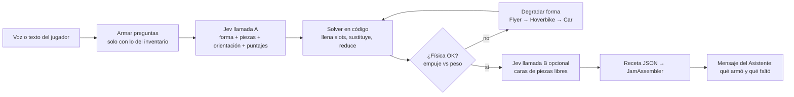

# 13 — Conocimiento de construcción para la IA (qué hace cada pieza, inventario, dirección)

> [!info]
> Convierte la ingeniería inversa de la referencia ([01](01-mecanicas-construccion.md), [03](03-mecanicas-vehiculos-dispositivos.md),
> [04](04-quimica-fisica-gdc.md)) en **reglas que el asistente puede usar para decidir** qué construir con lo que el jugador trae en
> el inventario. Los datos viven en **`Content/Game/Building/Data/BuildKnowledge.json`** (38 elementos y 14 plantillas), que el código y
> Jev leen. Etiquetas: **[code]** = ya existe en `Source/GameJamm/Building/`, **[todo]** = falta, **[inferencia]** = diseño nuestro.

> [!tip] Veredicto central
> La referencia no programa vehículos: programa **piezas con un comportamiento simple** y deja que la física las combine
> *(transcripción GDC 2024, ver [03](03-mecanicas-vehiculos-dispositivos.md) §3)*. Hacemos lo mismo:
> 1. **Cada pieza sabe hacer una cosa** (empujar, girar, quemar, levantar) según **la cara donde va pegada**.
> 2. **Jev decide la intención**: qué forma, qué piezas y cómo va orientada. Las preguntas se arman **en tiempo real solo con lo que tienes**.
> 3. **El código decide lo posible**: llena la forma con tu inventario, sustituye, reduce y revisa que la construcción pueda moverse o volar.
>
> Así "una rueda acostada con dos lanzallamas que gire y queme todo" sale aunque nadie la haya programado.

## 1. Modelo: capacidades, no piezas

La IA no piensa en "Fan" o "Wheel" sino en **capacidades** (`provides` en el JSON). Cada plantilla pide capacidades y el solver
elige la pieza que las da con lo que haya en el inventario.

| Capacidad | Qué significa | Piezas que la dan (en orden de preferencia) |
|---|---|---|
| `chassis` | Base a la que se pega todo | Plank, Panel, Block, Cylinder, Cart, Sled |
| `ground_drive` | Tracción con motor | Wheel, BigWheel → (sustituto pasivo) Ball, Sled |
| `spin` | Gira sobre sí misma y arrastra lo pegado | Wheel, BigWheel, Turntable |
| `thrust` / `burst_thrust` | Empuje continuo / de un uso | Fan / Rocket |
| `lift` | Sube | Fan en `Bottom`, Balloon, Hover |
| `glide` | Planea | Wing |
| `control` | Dirigir y encender todo | **Seat (infinito)** |
| `aim` | Apunta solo al enemigo | Head |
| `weapon_*` | Daño | Flamethrower, Frost, Shock, Laser, Cannon |
| `launch` | Lanza lo de encima | Spring |
| `anchor` | Fija al suelo | Stake |
| `shield` / `ram` / `weight` | Bloquear / embestir / contrapeso | Wall, Panel, Block |

## 2. Reglas de comportamiento por pieza (lo que la IA tiene que "saber")

Todas dependen de **la cara del padre donde va la pieza** (contrato de caras en
[CATALOGO-ELEMENTOS §0.1](../assets/CATALOGO-ELEMENTOS.md)).

| Pieza | Regla | En el código |
|---|---|---|
| Fan | Empuja **al revés de su cara**: en `Back` avanza, en `Bottom` sube, en `Left`/`Right` gira. Varios se suman | **[code]** empuje; consumo **[todo]** |
| Rocket | Igual que Fan pero muy fuerte durante 3 s; luego se apaga | **[code]** |
| Wheel / BigWheel | En `Left`/`Right` da tracción. **Como raíz** o acostada **gira sobre sí misma** y lo pegado gira con ella | Tracción **[code]**; **como raíz no gira: bug [todo]** |
| Turntable | Gira lo de encima a velocidad constante (torreta giratoria, aspersor) | **[todo]** |
| Flamethrower / Frost / Shock | Cono hacia afuera de su cara; daña o aplica estado a lo que toca. Si su base gira, el cono gira | Hoy solo una esfera de debug, **sin daño [todo]** |
| Cannon | Proyectil cada 1.5 s hacia afuera de su cara | Dispara **[code]**; daño **[todo]** |
| Balloon | Fuerza hacia arriba constante; fuego debajo = ×2 | **[code]** fuerza; interacción **[todo]** |
| Spring | Al activarse lanza lo de encima | **[todo]** |
| Head | Gira para apuntar al enemigo más cercano; lo de encima apunta con ella | **[todo]** |
| Stake | Clava la construcción al suelo (constraint al mundo) | **[todo]** |
| Seat | Te subes, diriges (§5) y enciende todo lo conectado. **Infinito: no gasta inventario ni energía** | Pieza **[code]**; montarse/dirigir **[todo]** |

La regla de la referencia de que "activar uno activa todos los dispositivos conectados" *(enciclopedia de la franquicia, ver
[01](01-mecanicas-construccion.md) §6)* se mantiene: **una tecla prende o apaga toda la construcción**.

## 3. Cómo decide el asistente (pipeline)

**3.1 Preguntas dinámicas [inferencia].** Antes de llamar a Jev, el juego genera las preguntas **con los tipos que tienes**
(más Seat, que siempre está). Si traes 2 Fan, 1 Plank y 1 Flamethrower, Jev solo puede elegir entre esos tres. Así **nunca propone
algo imposible**, y la llamada queda chica (Jev cobra por token de entrada *(doc 12)*). El inventario va en el `state`:
`{"request": "...", "inventory": {"Fan": 2, "Plank": 1, "Flamethrower": 1}}`.

**3.2 Llamada A (una sola petición, ~0.3 s):**

| Pregunta | Tipo Jev | Opciones |
|---|---|---|
| `shape` | Choice | Las 14 plantillas del JSON (`Car`, `Bike`, `Hoverbike`, `Flyer`, `Glider`, `Airship`, `Rocket`, `Turret`, `Spinner`, `Roller`, `Ram`, `Catapult`, `Wall`, `Free`) con su descripción `es` como criterio |
| `want_<Tipo>` | Noul ×N | Uno por tipo que tienes: "¿el jugador pide o necesita esta pieza?" (criterio = `behavior` + sinónimos) |
| `orientation` | Choice | `upright` (parada), `flat` (acostada), `inverted` (de cabeza) |
| `anchored` | Noul | ¿Quiere que se quede fija en su lugar? |
| `size` / `speed` / `aggression` | Score | Rúbricas de 1–5: cuántas piezas usar, potencia contra peso, cuántas armas |

**3.3 Solver de inventario (código, sin IA).** Es lo difícil, así que va en código y con tests:
1. Toma los **slots** de la plantilla (p. ej. Car: chasis ×1, `ground_drive` ×4 en pares, `control` ×1).
2. Para cada slot elige la pieza con esa capacidad que **tienes**, en el orden de `part_pref` y luego `substitutes`.
3. **Reduce** si no alcanza: 4 ruedas → 2, siempre en pares simétricos y respetando `min`. Si no llega al `min`, cambia de forma
   (Car sin ruedas → Sled o Hoverbike si tienes Fan).
4. Agrega las piezas extra que Jev marcó en `want_*` y no son slots, en la primera cara libre de su lista `faces`.
5. Respeta `max_parts` (21) y **descuenta del inventario** al construir. "Desarmar" lo devuelve.
6. Escribe el mensaje: *"Armé un Hoverbike con 2 ventiladores. No tenías ruedas, así que no salió el carro."*
7. **Pide materiales** si lo que pediste no sale ni reducido: el asistente responde con **lo que falta y dónde conseguirlo**
   (*"Para el carro te faltan 2 ruedas: hay en el campamento del río"*), usando la tabla de loot de cada campamento. Da dos
   opciones: **construir la versión reducida ahora** o **ir por el material**. Se puede **guardar la petición pendiente**, y cuando
   lootees lo que faltaba el asistente avisa *"ya tienes lo de tu carro"* y la construye con un botón.

**3.4 Chequeo físico [inferencia].** Con `mass_kg` del JSON: empuje hacia arriba (Fan en `Bottom` = 250 N ≈ 25 kg en el código actual)
contra la masa total. Si no vuela, degrada a una forma de suelo. Si una forma de suelo no tiene ni tracción ni empuje, avisa.

**3.5 Llamada B (opcional).** Solo en `Free`, o si el jugador dijo dónde ("el cañón arriba"): una Choice por pieza con las caras
válidas de esa pieza (`faces`).

## 4. Orientación y "anclado": la rueda que gira en su lugar

- `orientation` rota **toda la construcción** al spawnear: `flat` = 90° sobre X. Una rueda raíz acostada gira como un trompo y lo que
  lleva pegado (dos lanzallamas en `Left`/`Right`) barre un **anillo de fuego** (plantilla `Spinner`).
- `upright` con la rueda como raíz = **`Roller`**: rueda sola por el mapa con el arma de lado.
- `anchored` = Stake si lo tienes; si no, la construcción va suelta.
- **[todo] código:** (a) rueda raíz con motor propio: torque aplicado directo al cuerpo, porque no hay padre contra el cual girar.
  (b) Pasar `orientation` al `Origin` del ensamblador. (c) Que el mesh de cada pieza siga la cara (hoy un cohete en `Bottom` se ve acostado).

## 5. Dirección: el asiento (Seat) es infinito y no gasta energía

Decisión del equipo: **el control no debe ser un problema**. Toda construcción puede llevar un Seat aunque no lo hayas looteado,
y el Seat **no consume energía**.

| Input (montado en el Seat) | Qué hace | Cómo [inferencia] |
|---|---|---|
| W / S | Acelera / frena-reversa | Multiplica la potencia de Fan y Wheel (−1…+1); las ruedas invierten su velocidad |
| A / D | Gira izquierda / derecha | **Torque de yaw directo sobre la raíz** + diferencial en ruedas (izquierdas más lentas). Por eso **2 Fan + Plank + Seat ya se maneja de lado a lado** aunque los ventiladores no giren |
| Space / Ctrl | Sube / baja (si vuela) | Multiplica solo los Fan en `Bottom` |
| Automático | Se mantiene derecho | Torque PD que nivela pitch y roll (estabilizador suave). Evita que el hover se voltee |
| E | Prender / apagar toda la construcción | `UJamAssembler::SetBuildActive` sobre todo `Activate` |

Sin Seat, la construcción funciona sola (encendida va derecho), como en la referencia.

## 6. Energía

En la referencia todo dispositivo gasta energía de una batería global; esta solo se recarga en reposo, y las baterías pegadas a la
construcción se gastan primero *([03](03-mecanicas-vehiculos-dispositivos.md) §2)*. Los consumos de la tabla `energy_per_s` del
JSON son los de referencia (pozos/seg): Fan 0.156, emisores 0.18, cañón 0.3 y ruedas 0.015.

> [!warning] Decisión pendiente
> `use_energy` en el JSON está en `true`, pero falta decidir si entra en el MVP. Propuesta: **barra de energía por construcción**
> que se llena con las Battery que lleve; al vaciarse, la construcción se apaga. El Seat queda fuera (infinito). Si no hay tiempo,
> `use_energy: false` y el límite son las piezas del inventario.

## 7. Interacciones entre elementos (emergencia fingida con una tabla)

La referencia tiene un motor químico donde las interacciones salen solas *([04](04-quimica-fisica-gdc.md))*. En 2 días lo
**fingimos con una tabla** que el código revisa cuando dos efectos se tocan:

| A | B | Resultado |
|---|---|---|
| Flamethrower | Balloon (encima) | El globo sube ×2 |
| Flamethrower | Enemigo / torre | Daño en el tiempo (quemado) |
| Frost | Enemigo | Lento 50 % por 3 s |
| Frost | Agua | Plataforma de hielo |
| Shock | Agua / metal | La descarga se propaga |
| Hydrant | Fuego | Lo apaga |
| Head | Cannon / Laser / Flamethrower encima | Torreta autónoma |
| TimeBomb | Dispositivo cercano | La onda lo activa |
| Construcción a > 8 m/s | Enemigo | Daño por impacto según masa × velocidad |

## 8. Construir a mano y por voz (misma receta)

- **A mano:** eliges una pieza del inventario, apuntas a una cara de tu construcción (raycast → caja de la pieza → cara más cercana)
  y se agrega a la receta como `attach_to` + `socket`. Es el mismo layout que usa la IA, así que puedes **editar lo que armó la IA**.
  Rotar toda la construcción en pasos de 45° *([01](01-mecanicas-construccion.md) §2)*.
- **Voz:** grabar el micrófono (`AudioCapture`) → transcribir con Whisper vía fal (la key de fal ya está integrada) → el mismo texto
  del prompt. El texto siempre queda como respaldo.
- **Editar la última toma:** "más rápida", "ponle fuego": se manda la receta actual en el `state` y Jev decide qué agregar o cambiar.

## 9. Limitaciones conocidas

- `PART_BEAM` usa el tipo `Beam`, así que el emisor de haz del catálogo (`DEV_BEAM`) se llama **`Laser`** en el JSON para no chocar.
- Faltan en el código 26 de los 38 elementos (`in_code: false`). El solver solo debe ofrecer los que tienen `in_code: true` hasta que existan.
- Jev puede cambiar sus probabilidades si cambia el orden de las opciones *(doc 12)*: generar las preguntas siempre en el orden del JSON.

## → Aplicable a GameJamm

**P0 (sin esto el asistente no aprovecha el inventario):**
1. Cargar `BuildKnowledge.json` en `UJamPartCatalog` (tipos, masa, capacidades, sustitutos, sinónimos para el parser).
2. Preguntas dinámicas de Jev desde el inventario (§3.1–3.2) en `FJamDecisionClient`.
3. Solver de slots + sustitución + reducción + mensaje + **pedir materiales faltantes** (§3.3), con tests como los de `Building/Tests/JamRecipeTests.cpp`.
4. Rueda raíz que gira, y `orientation` (§4): habilita `Spinner` y `Roller`.
5. Daño real de Flamethrower y Cannon, más impacto por velocidad (§7).
6. Seat: montarse, W/S, A/D por torque de yaw, nivelado automático y E para prender/apagar (§5).
7. Consumir el inventario al construir y devolverlo al desarmar.

**P1:** Turntable, Head (torreta autónoma), Spring, Stake, Wing, chequeo físico de empuje contra peso, voz con Whisper, construcción a mano.

**P2:** energía por construcción (§6), interacciones de la tabla §7 más allá del daño, Frost/Shock/Laser, editar la última toma.

**Para empaquetar:** agregar `Content/Game/Building/Data` a *Additional Non-Asset Directories to Package*; si no, el JSON no viaja en la build.
